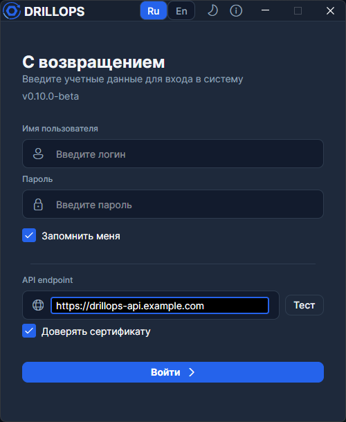
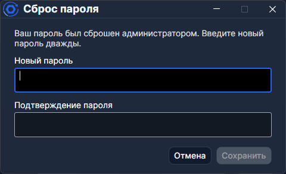

# Авторизация

## Сервер

Сначала укажите адрес вашего API в поле **API endpoint**. Если адреса нет под рукой — его выдаёт администратор.

Кнопка **Тест** проверяет, отвечает ли сервер.

> Флаг **Доверять сертификату** нужен только для самоподписанного SSL-сертификата.

## Учётные данные

Логин и пароль выдаёт администратор. Он же может сбросить пароль, если вы его забыли.

Если администратор потребовал сменить пароль, сначала войдите **текущим** (временным) паролем — программа проверит его. Затем откроется диалог **Сброс пароля**: введите **новый пароль** дважды и нажмите **Сохранить**. Новый пароль должен отличаться от текущего. После сохранения войдите уже с новым.

> Флаг **Запомнить меня** сохраняет логин между сессиями, но не сохраняет пароль.

## Если вход не проходит

Версии Desktop и API должны совпадать по **контракту**. Если сервер новее или старше клиента, программа не пустит и покажет, кого обновлять:

- сервер слишком старый — обновите API;
- приложение слишком старое — скачайте установщик со [страницы релизов](https://github.com/Vanilla76e2/DrillOps.Releases/releases) или согласитесь на обновление в диалоге **Требуется обновление**.

## Элементы экрана

Полный перечень панелей, кнопок, ПКМ и клавиш. Как пользоваться по задаче — в тексте выше. Общие жесты окна — в [продвинутом использовании](../Продвинутое%20использование.md).

