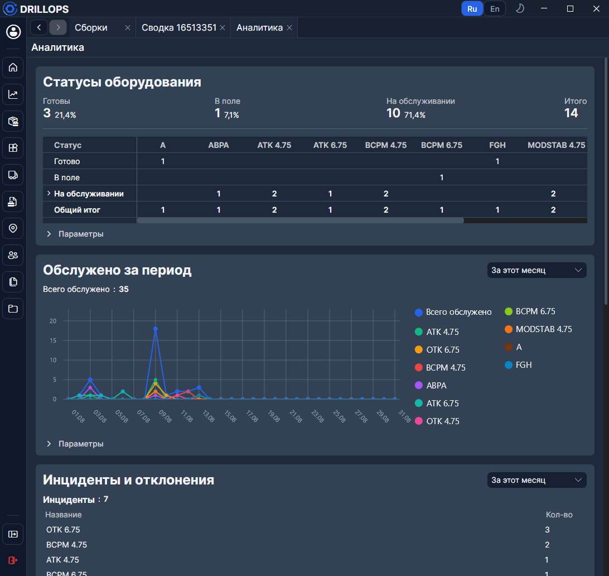

# Аналитика

Сводка по **головным** сборкам парка за выбранный период. Пункт меню **Аналитика** виден тем, у кого доступно [Обслуживание](../Рабочий%20цикл/Обслуживание.md). Данные только для просмотра.

## Блоки

- **Статусы оборудования** — [Готово / В поле / На обслуживании](../Справочники/Статусы%20оборудования.md) и разбивка по [шаблонам](../Справочники/Шаблоны.md).
- **Обслужено за период** — график закрытых нарядов.
- **Метров пробурено** — сумма метров из [рейсов](../Рабочий%20цикл/Рейсы.md) за выбранный период, с разбивкой по типу и серийному номеру.
- **Инциденты и отклонения** — из рейсов и [нарядов](../Рабочий%20цикл/Заказ-наряд.md). Можно сузить по серийному номеру.
- **Отправки по заказчикам** — круговая диаграмма.
- **Лента времени** — диаграмма Ганта, отображающая сроки отправок, обслуживания и работ в виде линий для каждого инструмента во времени.
- **Длительности MAX · AVG · MIN**: Срок обслуживания, Срок ожидания обслуживания, Срок ожидания отправки, Срок ожидания запчастей.

Чтобы узнать подробности одной сборки, откройте её [сводку](./Сводка.md).
