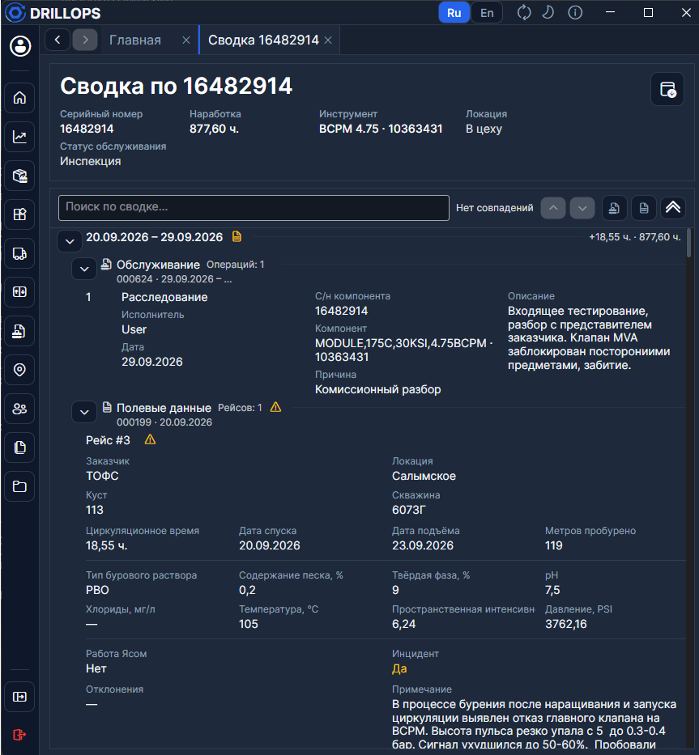

# Сводка

**Сводка** — хронология одной сборки: отправки, рейсы, обслуживание, возврат в готово. Это не пункт бокового меню — вкладка открывается из контекстного меню **Открыть сводку** на [Главной](../Рабочий%20цикл/Главная.md), в [Сборках](../Справочники/Сборки.md), [Обслуживании](../Рабочий%20цикл/Обслуживание.md), [Отправках](../Рабочий%20цикл/Отправки.md), [Рейсах](../Рабочий%20цикл/Рейсы.md) и из [полевых данных](../Рабочий%20цикл/Полевые%20данные.md).

>Если по этому серийному номеру ещё не было движения, увидите **История отсутствует**.

## Лента

Сегменты идут по времени: **Отправка**, **Полевые данные**, **Обслуживание**, **Готово**. Вложенный документ открывают кнопкой **Открыть** в контекстном меню. У отправок видны [дополнительные инструменты](../Рабочий%20цикл/Отправки.md). Значки предупреждения — **Инцидент** и **Отклонение** (как на [Главной](../Рабочий%20цикл/Главная.md)).

У каждого периода на шкале — часы **за этот интервал** и накопленная наработка. Часы берутся из [рейсов](../Рабочий%20цикл/Рейсы.md). У рейса отдельная строка с деталями; из неё открывают [полевые данные](../Рабочий%20цикл/Полевые%20данные.md) отправки.

**Раскрыть** / **Раскрыть всё** / **Скрыть всё** управляют детализацией. **Поиск по сводке** подсвечивает совпадения.

## Выгрузка

**Выгрузить в Excel** собирает листы **Сводка**, **Операции**, **Полевые данные**, **Матрицы вибраций**.

