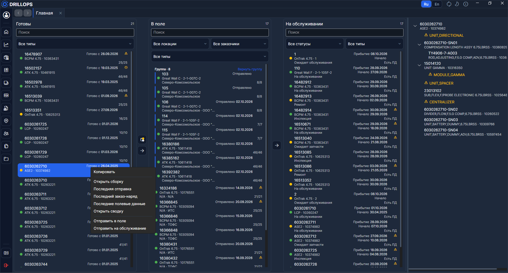
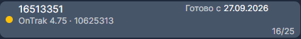
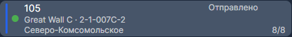
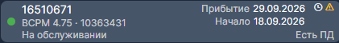
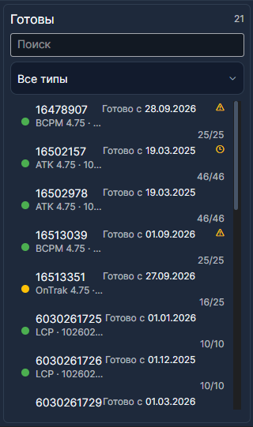
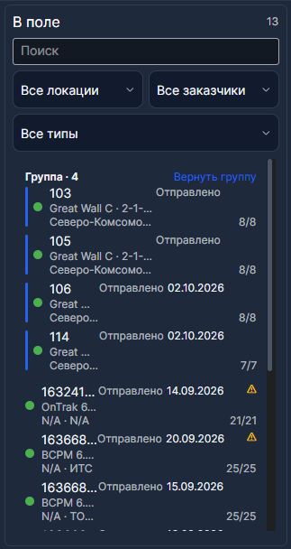
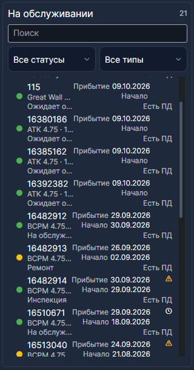
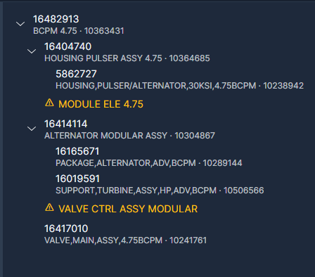

# Главная

На **Главной** три столбца с оборудованием. Сюда попадают [сборки](../Справочники/Сборки.md), собранные на основе [головных инструментов](../Справочники/Компоненты.md).

> С **Ctrl** или **Shift** можно выбрать несколько единиц и отправить их вместе в поле или на обслуживание.

В каждом столбце — поиск по серийному номеру, партийному номеру и наименованию сборки, плюс фильтр **по типу оборудования** ([шаблоны](../Справочники/Шаблоны.md) головных инструментов): можно отметить несколько типов сразу. Остальные фильтры зависят от столбца.

## Карточка сборки

На скриншоте у каждой строки слева — **индикатор комплектности**: зелёный кружок, если все [слоты](../Справочники/Шаблоны.md) заполнены, жёлтый — если нет. Справа внизу то же цифрами (`3/4`).

> Неполную сборку всё равно можно отправить в поле — программа спросит подтверждение (**Сборка … готова на 3/4, вы уверены?**).

В правом верхнем углу карточки — значки предупреждения:

- **Инцидент** — в [рейсе](./Рейсы.md) включён флаг **Инцидент** (подсказка при наведении).
- **Отклонение** — в последнем [заказ-наряде](./Заказ-наряд.md) есть операция **Отклонение**; значок может остаться и в **Готовы**, и **В поле**.
- **В очереди на отправку** — отмечает что инструмент в планируемой отправке, при наведении можно увидеть подробности. Имеет различную цветовую индикацию, подробнее в главе [Отправки](./Отправки.md).

- **Готово**

- **В поле**

- **На обслуживании**

> История по серийному номеру находятся в [сводке](../Отчёты/Сводка.md), а общие данные по парку в [аналитике](../Отчёты/Аналитика.md).

## Готовы

Сборки со статусом [Готово](../Справочники/Статусы%20оборудования.md) это сборки у которых завершено обслуживание. Отправить [В поле](./Отправки.md) или [на обслуживание](./Обслуживание.md) можно стрелкой на **Главной** или через контекстное меню по ПКМ.

Дополнительный фильтр: **по статусу оборудования**. 
В карточке видна дата **Готово с**. Это дата последнего закрытого заказ-наряда (когда завершилось обслуживание).

**Отправить в поле** открывает мастер [отправки](./Отправки.md).

**Запланированные отправки** находятся между колонками **Готовы** и **В поле** над кнопкой **Отправить в поле**. Эта кнопка отображает Запланированные отправки, и из неё же можно выполнить запланированную отправку, отменить её или изменить.

## В поле

Сборки со статусом [В поле](../Справочники/Статусы%20оборудования.md). Отсюда их можно отправить [на обслуживание](./Обслуживание.md) стрелкой или через контекстное меню.

Дополнительные фильтры — [по локации](../Справочники/Локации.md) и [по заказчику](../Справочники/Заказчики.md).

**Синяя линия** слева означает что оборудование сгруппировано и уехало вместе.
Над первым элементом группы отображается сгенерированный номер группы и кнопка **Вернуть группу**, отправляет на обслуживание сразу всю группу.

> Сгруппированное оборудование всё ещё можно отправлять на обслуживание по отдельности.

## На обслуживании

Сборки со [статусом из категории обслуживания](../Справочники/Статусы%20оборудования.md). Вручную их отсюда переместить нельзя: после закрытия [обслуживания](./Обслуживание.md) они сами вернутся в **Готовы**.

В строке видно **Есть ПД** / **Нет ПД** — была ли у сборки [отправка](./Отправки.md). Окно [полевых данных](./Полевые%20данные.md) совпадает с этой отправкой. Сами рейсы заводят на вкладке [Рейсы](./Рейсы.md).

Дополнительный фильтр — **по статусу оборудования**.

Заказ-наряд из этого столбца можно открыть пунктом **Открыть обслуживание** контекстного меню на ПКМ.

## Структура оборудования

Справа на скриншоте — **текущая** структура выбранной [сборки](../Справочники/Сборки.md). Пустые [слоты](../Справочники/Шаблоны.md) подсвечены предупреждающим цветом.

> Ширину панели можно изменить, потянув за левый край.

