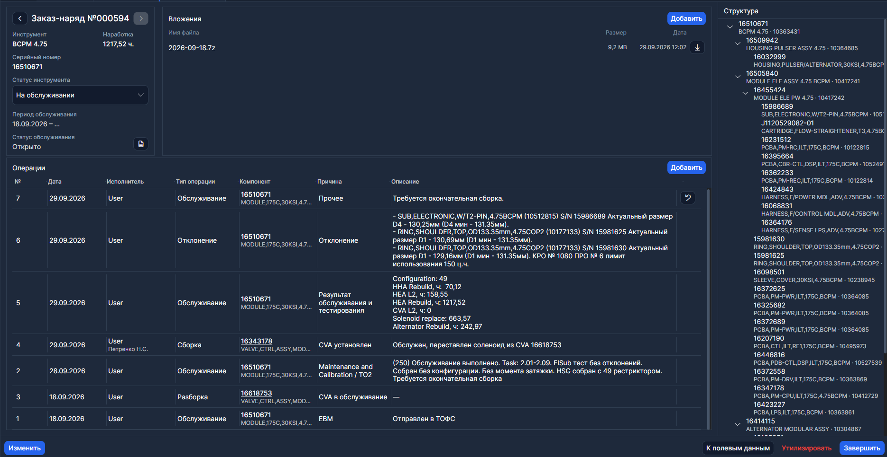
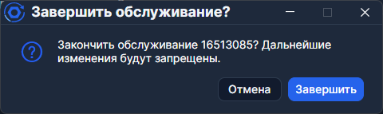

# Заказ-наряд

**Заказ-наряд** (ЗН) — документ работ по обслуживанию. Его заводят на [сборку](../Справочники/Сборки.md) или на [отдельный компонент](../Справочники/Компоненты.md). Можно открыть из [Обслуживания](./Обслуживание.md), с [Главной](./Главная.md) (пункт **Последний заказ-наряд** или **Открыть обслуживание**) или из [Сборок](../Справочники/Сборки.md). Вкладка называется **ЗН №…** / **Заказ-наряд №…**.

Создать наряд можно кнопкой **+** в [таблице обслуживания](./Обслуживание.md) или пунктом **Открыть обслуживание** с [Главной](./Главная.md). Для компонента без сборки наряд открывается при извлечении компонента или из вкладки [Компоненты](../Справочники/Компоненты.md). Рейсы к этому моменту уже лежат в [журнале рейсов](./Рейсы.md), а [полевые данные](./Полевые%20данные.md) их только отображают.

Если у компонента есть [шаблон](../Справочники/Шаблоны.md) сборки, а самой сборки ещё нет, программа **создаст сборку** при заведении записи обслуживания.

В шапке наряда видна **наработка** в часах на момент документа.

Пока наряд открыт, **Структура** — живое дерево сборки. Если сборки ещё нет, дерево появится после первой операции, которая её подставит. После **Завершить** программа сохраняет снимок: так видно, в каком составе инструмент закрыли.

Кнопки **К обслуживанию** и **К полевым данным** ведут к связанным документам.

## Операции

Кнопка **Добавить** открывает мастер создания операции. Подробно про мастер, типы операций, отмену и виртуальные строки в наряде на компонент — на отдельной странице [Операции](./Операции.md).

Из дерева **Структура** операцию можно завести быстрее: ПКМ по компоненту или пустому слоту → **Создать операцию**. Мастер откроется уже с выбранным узлом. Как это выглядит и какие ещё жесты есть — в [продвинутом использовании](../Продвинутое%20использование.md).

## Вложения

Файлы добавляют кнопкой **Добавить** или перетаскиванием. Их можно скачать и удалить. Менять вложения можно только в режиме **Изменить**.

> Файлы можно открыть двойным щелчком мыши. 
> **Имейте ввиду что изменения внесённые в документ не отправятся на сервер.** Если вам нужно внести изменения то придётся удалить и загрузить файл заново.

## Завершение

**Завершить** открывает диалог **Завершить обслуживание?**. Если сборка не укомплектована, программа предупредит и предложит **Завершить всё равно**.

После закрытия обычные правки запрещены. Администратор может переоткрыть документ через **Изменить**.

Отдельно есть действие **Утилизировать** — для списания инструмента вместе со всеми его комплектующими. Если вы **не хотите** утилизировать какие-то из компонентов, вам необходимо предварительно их извлечь.

Если в то время пока у вас открыто редактирование заказ-наряда, его изменят на сервере, появится баннер **Принять обновление** / **Оставить мои изменения**. Это конфликт редактирования, а не обновление самой программы. 
**Принять обновление** заменит все введённые вами данные на актуальные с сервера, а **Оставить мои изменения** проигнорирует обновление и перепишет их при сохранении. 