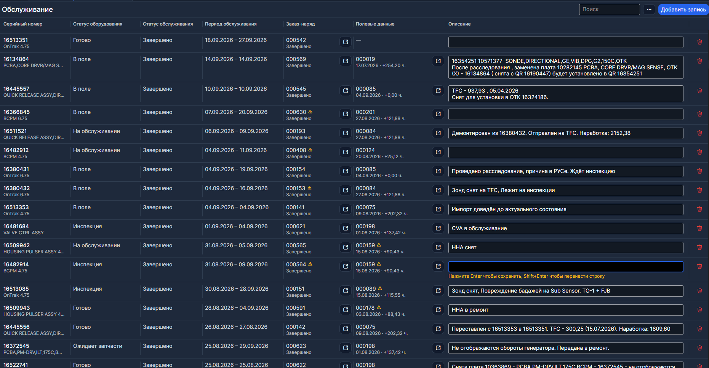
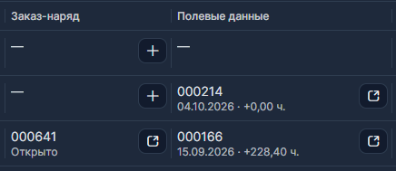

# Обслуживание

Здесь ведётся **история обслуживания** оборудования: открываются [полевые данные](./Полевые%20данные.md) отправки и заводятся [заказ-наряды](./Заказ-наряд.md). Рейсы в эту таблицу вписывать не нужно — их журнал на вкладке [Рейсы](./Рейсы.md).

Запись можно завести на [сборку](../Справочники/Сборки.md) или на [отдельный компонент](../Справочники/Компоненты.md). Если у компонента есть шаблон сборки, а сборки ещё нет, программа создаст её вместе с записью.

> Чтобы сохранить текст в **Описании**, нажмите **Enter**.
> Чтобы сделать перенос строки в **Описании** нажмите **Shift+Enter**

## Полевые данные и заказ-наряд

В ячейке **Полевые данные** отображают **номер отправки**. [Полевые данные](./Полевые%20данные.md) это сборник [рейсов](./Рейсы.md) которые попали в [отправку](./Отправки.md), а не отдельный  документ.

Заказ-наряд создаётся кнопкой **+** в своей ячейке. Для компонента без сборки наряд открывается так же.

В ячейке полевых данных под номером отправки видны дата отправки и сумма **часов наработки** по рейсам отправки.

## Поиск и фильтры

Поиск ищет по серийному номеру, наименованию, номеру заказ-наряда, номеру полевых данных и описанию.

Фильтры в меню **⋯**: по периоду, по [статусу оборудования](../Справочники/Статусы%20оборудования.md), по типу оборудования, по статусу обслуживания.

> В фильтре периода выберите начало и конец — в таблице останутся записи, попавшие в диапазон.

## Статусы обслуживания

Это статус **записи**, не статус самой сборки:

- **Ожидает ЗН** — запись есть, наряда ещё нет.
- **Открыто** — заказ-наряд открыт, работы идут.
- **Завершено** — наряд закрыт.

> Незавершённые записи всегда выше завершённых.