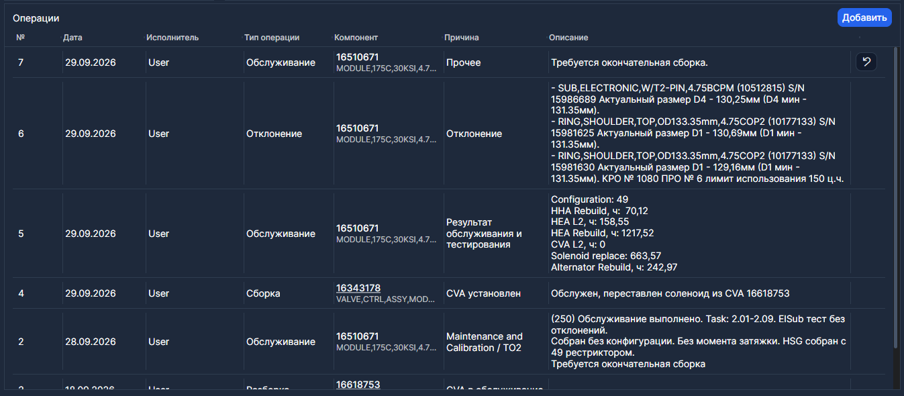
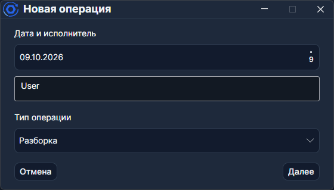
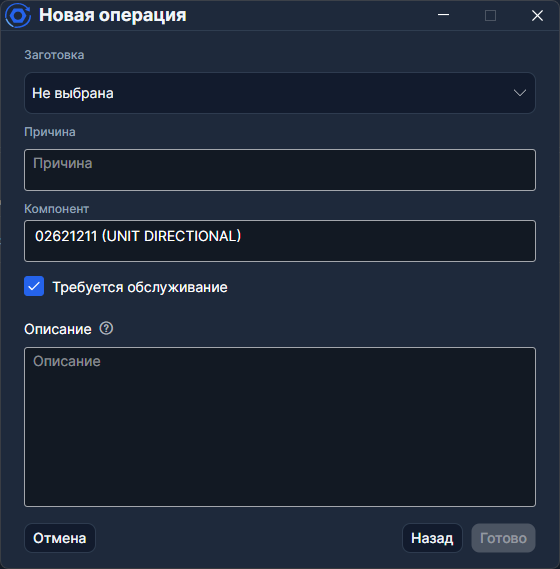

# Операции

Операции — записи о работах внутри [заказ-наряда](./Заказ-наряд.md). Каждая строка в таблице **Операции** описывает одно действие над сборкой или её компонентом: ремонт, замену, инспекцию и т.д.

## Мастер «Новая операция»

Кнопка **Добавить** в таблице операций открывает мастер из двух шагов.

### Шаг 1 — Дата, исполнитель и тип

Выберите **дату**, **исполнителя** и **тип операции**. Если выбран внешний сотрудник, программа допишет «Заполнил: ваше имя».

Тип определяет, что произойдёт дальше — для **Разборки** и **Сборки** появятся дополнительные поля выбора компонента.

### Шаг 2 — Причина, компонент и описание

- **Заготовка** — Заполняет данные согласно подготовленной заготовке во вкладке [Заготовки](../Сервис/Заготовки%20описаний.md).
- **Причина** — обязательное текстовое поле.
- **Описание** — свободный текст.
  
  Выберите **заготовку описания**, и текст заполнится автоматически. 
  Выделите фрагмент и нажмите **Ctrl+W**, чтобы подсветить его жёлтым как предупреждение (повтор снимает отметку). Подробнее — в [продвинутом использовании](../Продвинутое%20использование.md).

Для операций **Разборка** и **Утилизация** нужно выбрать **компонент** из дерева сборки. Для **Сборки** — **слот**, куда ставить, и **компонент** из доступных.

> При извлечении любого компонента появляется флаг **Требуется обслуживание**. Если он включён, извлечённый компонент или сборка уйдёт на обслуживание, а не в статус «Готово». Без прав администратора флаг включён и его нельзя снять.

Если у заказ-наряда ещё нет сборки, операция заведёт по [шаблону](../Справочники/Шаблоны.md). После этого в дереве появятся слоты.

Нажмите **Готово** — операция появится в таблице.

## Типы операций

Не все типы одинаковые: одни меняют структуру сборки, другие фиксируют факт работы, третьи влияют на статус оборудования на [Главной](./Главная.md).

### Работа с компонентом

| Тип            | Что делает                                                                                                                                                                         |
| -------------- | ---------------------------------------------------------------------------------------------------------------------------------------------------------------------------------- |
| **Разборка**   | Извлекает компонент из слота. Выбор — из дерева сборки.  Можно выбрать только компонент текущей сборки. Т.е. нельзя выбрать компонент сборки находящейся внутри текущей сборки. |
| **Сборка**     | Устанавливает компонент в свободный слот. Разрешена сборка только с компонентами в статусе **Готово**. Т.е. если компонент **На обслуживании**, то его установить нельзя.       |
| **Утилизация** | Извлекает и списывает компонент.                                                                                                                                                   |

### Документирующие

| Тип                    | Что делает                                                                                     |
| ---------------------- | ---------------------------------------------------------------------------------------------- |
| **Инцидент**           | Фиксирует инцидент в наряде.                                                                   |
| **Отклонение**         | Даёт значок предупреждения на [Главной](./Главная.md) и в [аналитике](../Отчёты/Аналитика.md). |
| **Расследование**      | Запись о расследовании причин.                                                                 |
| **вход. Тестирование** | Проверка при поступлении на обслуживание.                                                      |
| **исх. Тестирование**  | Проверка при завершении обслуживания.                                                          |

### Статусные

| Тип                    | Что делает                                 |
| ---------------------- | ------------------------------------------ |
| **Ожидание запчастей** | Устанавливает статус **Ожидает запчасти**. |
| **Карантин**           | Устанавливает статус **Карантин**.         |
| **Ремонт**             | Устанавливает статус **Ремонт**.           |
| **Обслуживание**       | Устанавливает статус **На обслуживании.**  |
| **Инспекция**          | Устанавливает статус **Инспекция**.        |
| **Опрессовка**         | Устанавливает статус **Опрессовка**.       |

## Ссылки в таблице

В колонке **С/н компонента** серийный номер бывает подчёркнут. Это ссылка на другой заказ-наряд. Если открывать некуда, номер остаётся обычным текстом. Правый щелчок по ссылке — **Копировать**.

В наряде сборки ссылка есть у **Разборки** и **Сборки**. Подсказка: **Открыть заказ-наряд компонента**.

- **Разборка** открывает наряд, который программа завела на эту деталь при извлечении.
- **Сборка** открывает последний наряд этого компонента.

У виртуальной строки ссылка ведёт в наряд сборки, где деталь сняли или поставили. Подсказка: **Открыть заказ-наряд сборки**.

## Виртуальные операции

В [заказ-наряде](./Заказ-наряд.md) на компонент в таблице бывают строки со статусом **Виртуальная**. Это не отдельная работа: программа показывает, что с этой деталью сделали.

Таких строк не больше двух, по одной на последнее событие:

| Строка          | Что означает                                                       |
| --------------- | ------------------------------------------------------------------ |
| **Извлечено**   | Деталь сняли со сборки. Под серийным номером написано **Откуда**.  |
| **Установлено** | Деталь поставили в сборку. Под серийным номером написано **Куда**. |

Серийный номер в строке — сборка, в которой прошла **Разборка** или **Сборка**. Это ссылка на её заказ-наряд, там лежит настоящая операция.

У виртуальной строки нет номера. Её нельзя изменить и нельзя отменить из наряда компонента. Если разборку или сборку отменят в наряде сборки, строка исчезнет. Если до этого деталь уже снимали или ставили, на её месте останется предыдущий такой случай.

## Отмена операции

**Отменить операцию** не удаляет строку — запись остаётся в журнале со статусом **Отменена**, а эффекты (извлечение, установка, смена статуса) откатываются.

По умолчанию отменённые операции скрыты. Кнопка **Показать N отменённых** раскрывает их в таблице.

> Отменить можно только **верхнюю** (последнюю) операцию.

