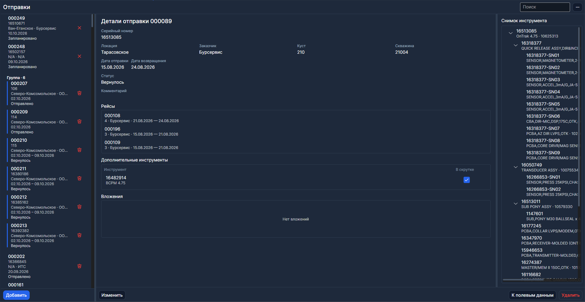
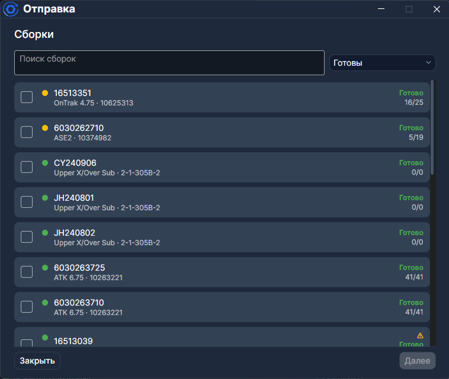
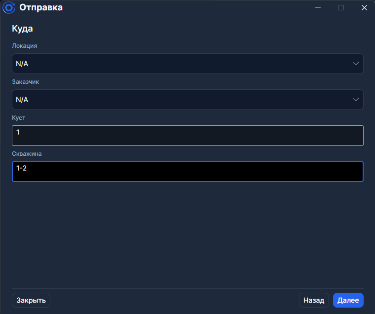
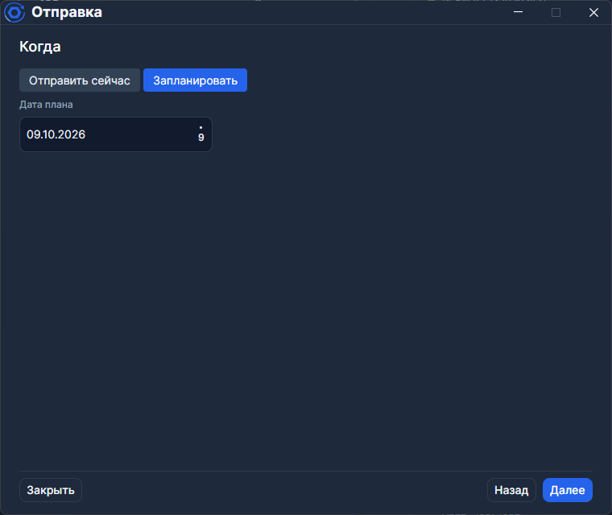
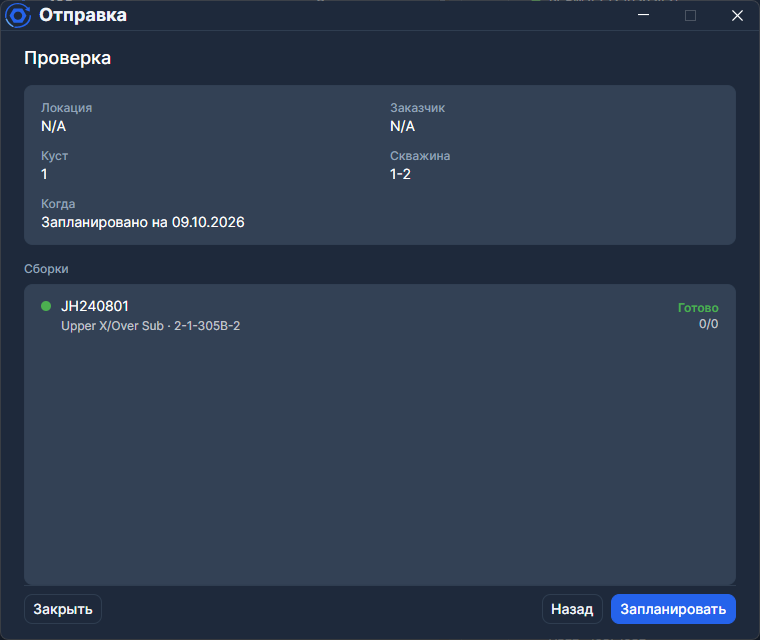
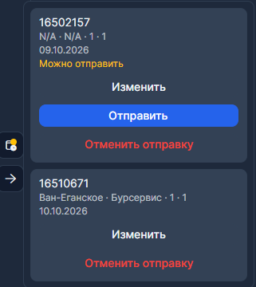

# Отправки

**Отправка** — куда уехала [сборка](../Справочники/Сборки.md), на какой срок и в каком составе. Это не журнал бурения: спуски и параметры рейса ведут на вкладке [Рейсы](./Рейсы.md). Полевые данные отправки — список рейсов, которые попали в её даты.

Справа — **снимок инструмента** на момент отправки. Структура зафиксирована и дальше не меняется вместе с живой сборкой.

> Ширину снимка можно изменить потянув за левый край.

У каждой записи свой номер. Тот же номер виден в шапке [полевых данных](./Полевые%20данные.md) этой отправки.

## Как появляется запись

Отправку создают мастером **Отправка**:

- с [Главной](./Главная.md) — **Отправить в поле** на карточке в столбце **Готовы**;
- со страницы отправок — кнопка **Добавить**.

Шаги мастера:

- **Сборки** — Можно выбрать несколько инструментов, чтобы их сгруппировать.

- **Куда** — Необходимо заполнить данные отправки.

- **Когда** — Можно отправить сразу или запланировать отправку.
	
    - **Отправить сейчас** — сборка сразу уходит в столбец **В поле**. Так можно отправить только сборки из **Готовы**. Если выбранная сборка уже в поле или на обслуживании, программа оставит только план.
    
	- **Запланировать** — сборка остаётся на месте, появляется запись со статусом **Запланировано** и датой плана (сегодня или позже).
  

- **Проверка** — Выводит всю введённую информацию в одном окне, чтобы вы могли убедиться что всё заполнено верно.
  

Если сборок несколько, на проверке одна помечается как **Основная**, остальные — **В скрутке** или **Вместе**. Неполную сборку отправить можно: программа спросит подтверждение.

Пошагово — в сценарии [Как отправить в поле](../Сценарии/Как%20отправить%20в%20поле.md).

> Дата возвращения ставится сама, когда сборку с [Главной](./Главная.md) отправляют на обслуживание. Статус отправки ставится **Вернулось**.

## Запланированные

На [Главной](./Главная.md) у столбца **Готовы** есть список **Запланированные отправки**.

- **Можно отправить** — все сборки уже **Готовы**, их можно отправить кнопкой в этом списке или кнопкой **Отправить** в карточке отправки.
- **Нельзя отправить** — сборка ещё не готова. Запись плана при этом сохраняется.

> Щелчок по строке плана открывает отправку во вкладке **Отправки**.

## Список и поиск

> Ширину списка можно поменять, потянув за правый край панели.

Поиск — по номеру отправки, серийному номеру, заказчику, локации, кусту и скважине. 
Фильтры в меню **⋯**: **по типу оборудования**, **по локации**, **по заказчику**, **по периоду** и **по статусу отправки** (По умолчанию только отправленные).

> В фильтре периода выберите начало и конец диапазона — в списке останутся отправки, попавшие в эти даты.

## Карточка

В карточке видны серийный номер, локация, заказчик, куст, скважина, **дата отправки**, **дата возвращения** и статус. Локация, заказчик и даты задаются мастером. В режиме **Изменения** можно редактировать **комментарий**, **дополнительные инструменты** и **вложения**.

### Дополнительные инструменты

Нужны, когда несколько единиц уехали вместе. Выберите сборку и нажмите **Добавить**, затем при необходимости включите **В скрутке**.

В список добавления попадают сборки с той же локацией и датой отправки.

### Вложения

Файлы можно добавить кнопкой **Добавить** или перетаскиванием. После загрузки файл могут скачать другие пользователи.

## Связь с рейсом

ПКМ по строке отправки → **Создать рейс**. Откроется вкладка [Рейсы](./Рейсы.md): новый рейс уже привязан к этой отправке, подставлены заказчик, локация, куст, скважина и состав.

Рейс можно сохранить, только если **дата спуска** и **дата подъёма** целиком лежат внутри отправки каждого инструмента в составе. Открытая отправка без даты возвращения считается до сегодняшнего дня.