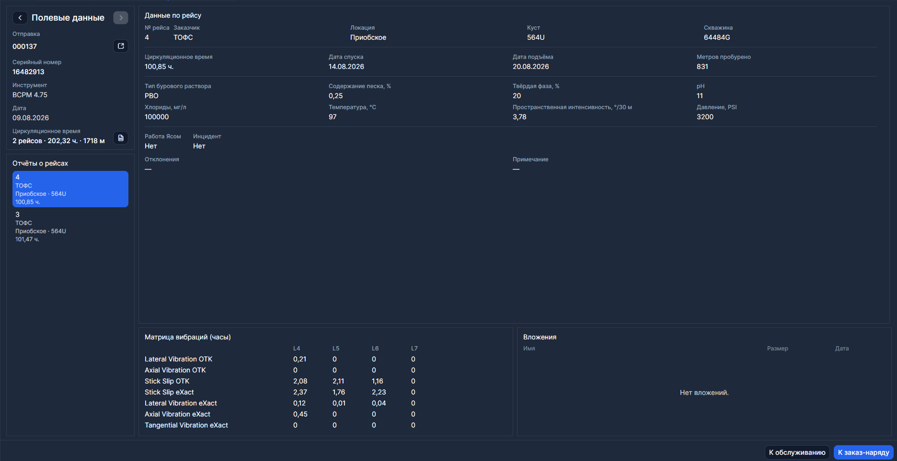

# Полевые данные

**Полевые данные** — рейсы одной [отправки](./Отправки.md). Это не отдельный документ и данные рейса здесь заполнить нельзя. Рейс создаётся на вкладке [Рейсы](./Рейсы.md). На экране те рейсы, где эта сборка стоит в составе КНБК и спуск попал в дни этой отправки.

В меню этого экрана нет. Его можно открыть из [обслуживания](./Обслуживание.md), с [Главной](./Главная.md), из [отправки](./Отправки.md), из строки [рейса](./Рейсы.md) и из [сводки](../Отчёты/Сводка.md).

## Шапка

- Стрелки по краям заголовка — **предыдущий** и **следующий** документ полевых данных этой по серийному номеру.
- **Отправка** — номер отправки. Кнопка рядом открывает её карточку.
- Серийный номер и имя сборки.
- **Дата** — период который инструмент находился в поле.
- **Циркуляционное время** — сумма часов по рейсам, которые видны в списке.
- Кнопка документа открывает [сводку](../Отчёты/Сводка.md).

## Список рейсов

Слева — **Отчёты о рейсах**. В строке видны номер рейса, заказчик, локация и циркуляционное время. Если рейс ещё не выбран, справа написано **Рейс ещё не выбран**.

Новый рейс отсюда не добавляют. ПКМ по строке:

- **Открыть** — карточка на вкладке [Рейсы](./Рейсы.md), там же правят и сохраняют;
- **Открыть заказ-наряд** позволяет открыть заказ-наряды других инструментов того же рейса.

Если у рейса есть история, под строкой можно выбрать прошлую версию. Отличия от текущих значений подсвечиваются. **К текущим** возвращает последнюю версию.

Справа — **Данные по рейсу** и **матрица вибраций**. Поля только для чтения. Вложения рейса, если они уже есть, видны рядом; добавить файл на этом экране нельзя.