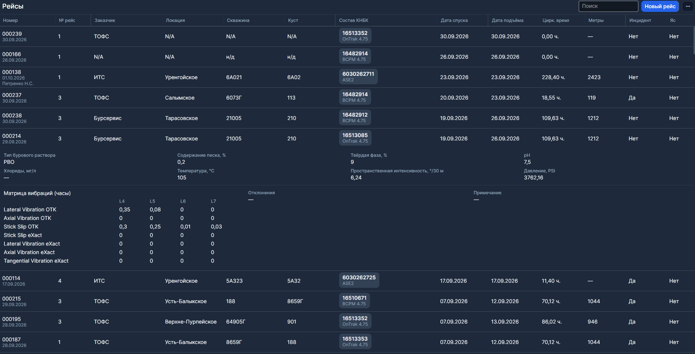
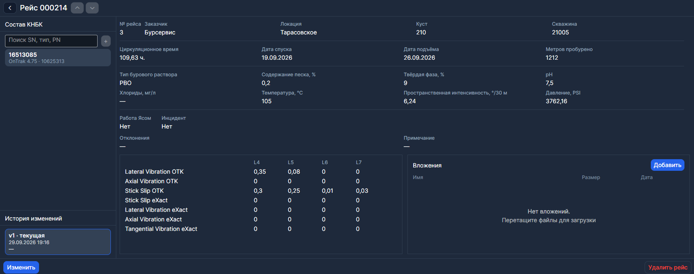

# Рейсы

**Рейсы** — журнал работ. Пункт есть в боковом меню. Здесь можно завести рейс и внести все необходимые данные.

Рейс живёт отдельно от карточки обслуживания. В [полевые данные](./Полевые%20данные.md) он попадает сам, если дата спуска лежит в окне [отправок](./Отправки.md) сборок в составе.

## Список

Щелчок по строке раскрывает детали рейса. Двойной щелчок или ПКМ → **Открыть** открывает карточку.

Поиск — по тексту строки. 
Фильтры в меню **⋯**: заказчик, локация, скважина, куст, **период работы**, инцидент (**все** / **да** / **нет**). Локацию, скважину и куст можно отметить несколько сразу.

Если рейсов нет, таблица пишет **Рейсов пока нет**.

## Новый рейс

**Новый рейс** открывает пустую карточку. Сверху, только у нового рейса, есть список **Из отправки**.

Выберите отправку — подставятся заказчик, локация, куст, скважина и инструменты из её состава. Поля после этого можно поправить. Пункт **— не выбрана —** оставляет карточку пустой.

Тот же старт с отправки: в [журнале отправок](./Отправки.md) ПКМ → **Создать рейс**.

### Состав КНБК

Слева выбирается сборка по серийному номеру, типу или партийному номеру и добавляется кнопкой **+**. Нужен хотя бы один инструмент. Лишний можно убрать крестиком.

### Заполнение

Обязательные поля: № рейса, заказчик, локация, куст, скважина.

**Сохранить** записывает рейс. **Отменить** сбрасывает несохранённое. **Удалить рейс** запрашивает подтверждение.

> Даты рейса должны целиком лежать внутри отправки **каждого** инструмента. Т.е. рейс должен быть в пересечении дат, когда все инструменты были в поле. Если окно не находится, программа пишет **Даты рейса вне отправок**. Открытая отправка без возврата действует до сегодняшнего дня.

Инцидент из рейса виден значком на карточке сборки на [Главной](./Главная.md).

## Правка и история

Уже сохранённый рейс открывается для просмотра. **Изменить** включает правку, затем снова **Сохранить**.

Слева внизу — **История изменений**: кто и когда правил рейс. Щелчок по версии показывает её. Текущая помечена как **текущая**.

Стрелки в шапке — **Предыдущий рейс** и **Следующий рейс**. **Назад** возвращает к таблице.
