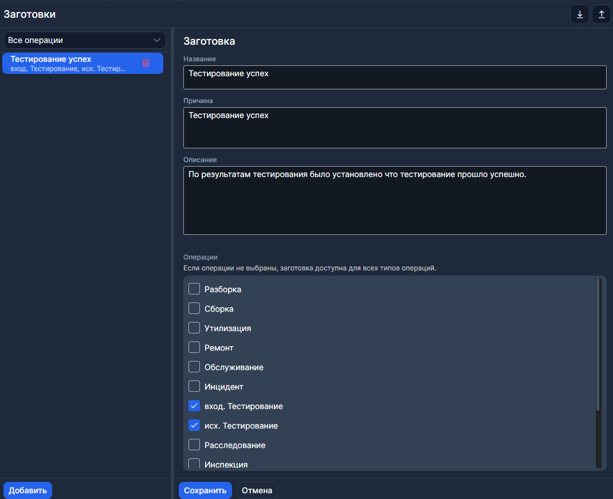

# Заготовки описаний

Справочник текстов для операций [заказ-наряда](../Рабочий%20цикл/Заказ-наряд.md). В меню пункт **Заготовки**, страница — **Заготовки описаний**. Раздел доступен всем пользователям.

**Экспорт** сохраняет все заготовки, не только видимые после фильтра.

В заготовке заполняется либо **причина**, либо **описание**, либо и **то и другое**. Подставляться будет только заполненное поле.

Также заготовки можно привязать к **операциям**. По умолчанию ни одна из операций не выбрана, что значит что заготовка доступна для всех операций.

## Импорт и экспорт

**Экспорт** сохраняет заготовки в JSON, **Импорт** загружает такой файл. При конфликте имён — **Заменить**, **Пропустить** или **Сохранить копию**. 
**Применить ко всем** повторяет выбор для остальных.

