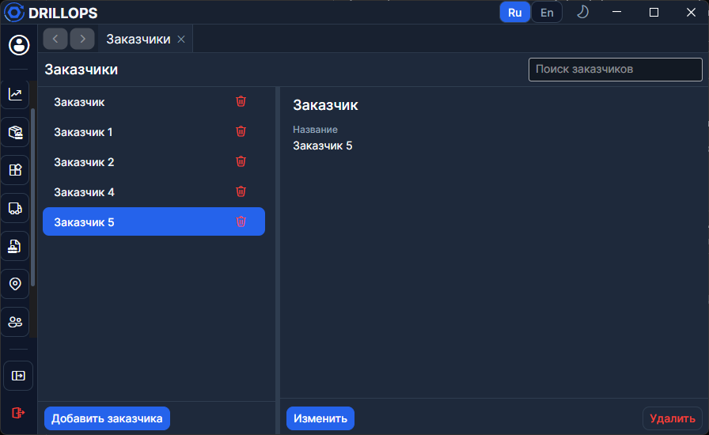

# Заказчики

Справочник организаций, куда уезжает инструмент. Заказчика выбирают в мастере [отправки](../Рабочий%20цикл/Отправки.md) и в карточке [рейса](../Рабочий%20цикл/Рейсы.md).

## Как работать

- **Добавить заказчика** — новая карточка. Обязательно **Название**.
- **Изменить** → правки → **Сохранить** или **Отмена**.
- **Удалить** — с подтверждением.

Кнопки создания и правки видны только при праве записи.

> Если карточку одновременно меняют на сервере, появится баннер **Принять обновление** / **Оставить мои изменения**.

## Элементы экрана

Полный перечень панелей, кнопок, ПКМ и клавиш. Как пользоваться по задаче — в тексте выше. Общие жесты окна — в [продвинутом использовании](../Продвинутое%20использование.md).

Строки `_заполнить_` — заготовка: сюда потом попадёт всё, что есть на экране.

### Панели

| Панель | Размер | Что внутри |
| --- | --- | --- |
| _заполнить_ | тянется за край / фиксирована | _заполнить_ |

### Кнопки и поля

| Где | Элемент | Действие |
| --- | --- | --- |
| _заполнить_ | _заполнить_ | _заполнить_ |

### Контекстное меню

| По чему ПКМ | Пункты |
| --- | --- |
| _заполнить_ | _заполнить_ |

### Клавиши этой вкладки

| Клавиши | Действие |
| --- | --- |
| _нет своих_ | см. [продвинутое использование](../Продвинутое%20использование.md) |
