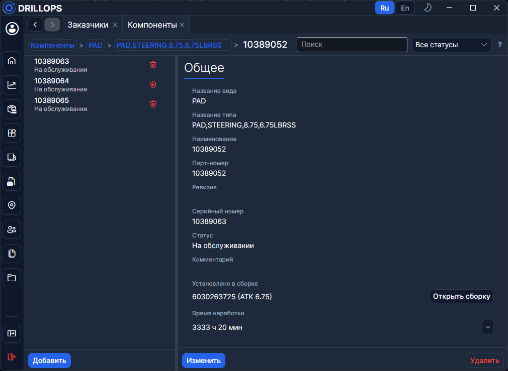
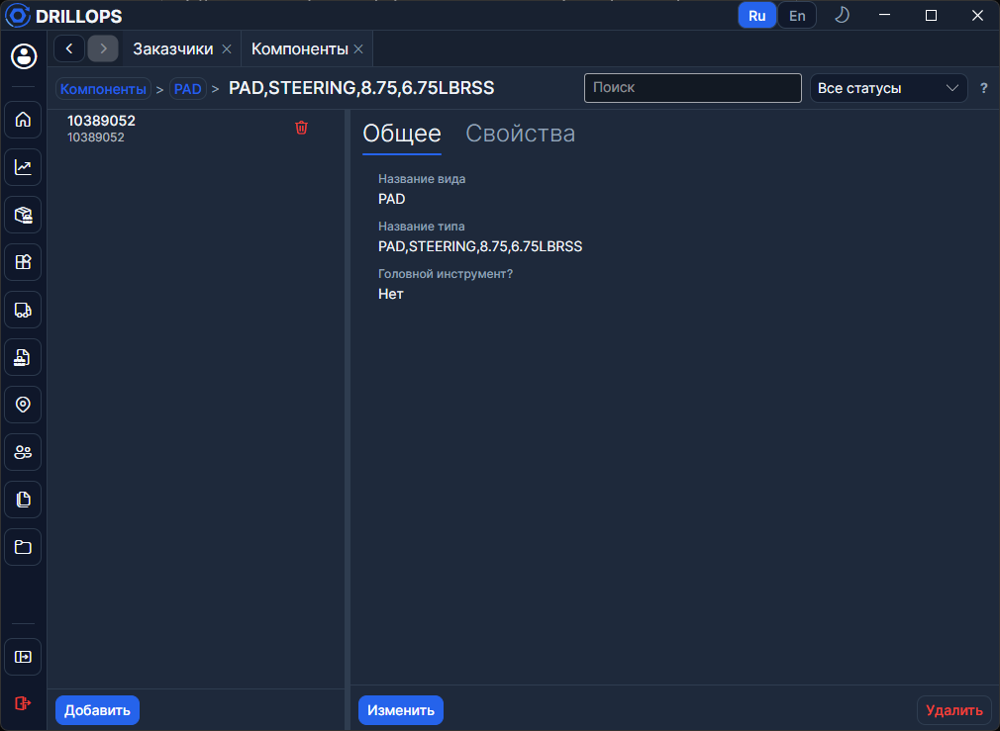
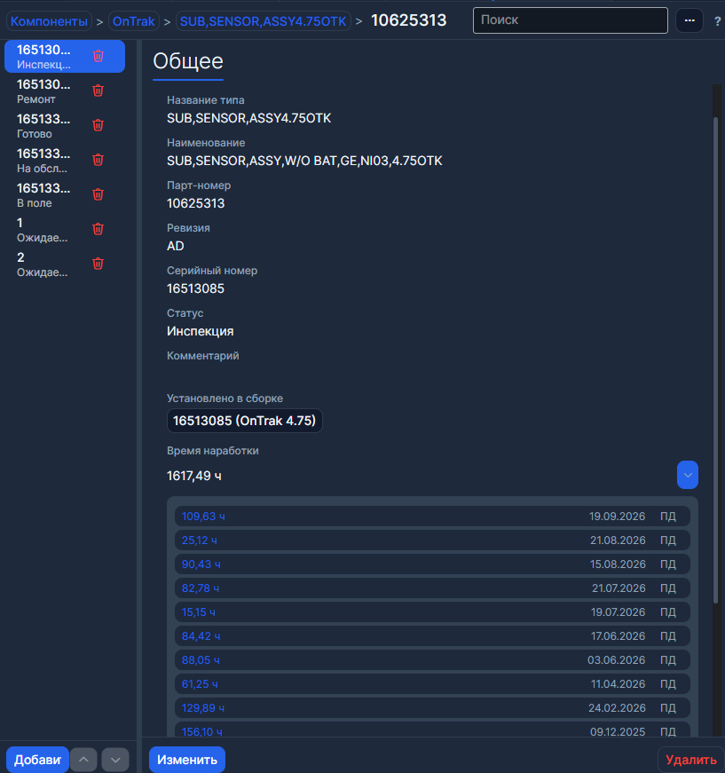

# Компоненты

Номенклатура деталей РУС: от видов и типов до экземпляров с серийным номером. Иерархия **Вид → Тип → Вариант → Компонент** — по дереву ходят хлебными крошками.

Сверху — **Поиск** и фильтр по [статусу оборудования](./Статусы%20оборудования.md). Поиск смотрит и по **комментарию**; комментарий виден в списке под серийным номером. Значок **?** справа показывает горячие клавиши списка; полный перечень — в [продвинутом использовании](../Продвинутое%20использование.md).

## Головные инструменты

На уровне **Типа** стоит флаг **Головной инструмент?**. Только сборки по шаблонам таких типов попадают на [Главную](../Рабочий%20цикл/Главная.md).

>Там же задают **пороги матрицы вибраций в часах**.

## Карточка компонента

Серийный номер и парт-номер должны быть уникальными.

Компонент либо **не установлен**, либо стоит в [сборке](./Сборки.md). Из дерева сборки его назначают в слот или извлекают.

### Наработка

В карточке — **время наработки** в часах (с сотыми). Часы из [рейсов](../Рабочий%20цикл/Рейсы.md) приходят с сервера и только для чтения; вручную можно добавить свои строки. Из строки, взятой из рейса, открывается исходный документ.

На [сборке](./Сборки.md), в [заказ-наряде](../Рабочий%20цикл/Заказ-наряд.md) и в [сводке](../Отчёты/Сводка.md) те же часы показаны как поле **Наработка**.

