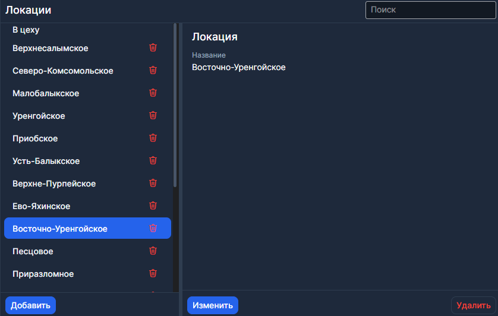

# Локации

Справочник мест. Это **не** привязка к [заказчику](./Заказчики.md): локации живут отдельно.

Локацию выбирают в мастере [отправки](../Рабочий%20цикл/Отправки.md) и в карточке [рейса](../Рабочий%20цикл/Рейсы.md). В колонке **В поле** на [Главной](../Рабочий%20цикл/Главная.md) фильтруют по локации и по заказчику. Скважина — отдельное поле отправки и рейса, не название локации.

## Как работать

Обязательно **Название**. **Добавить** / **Изменить** / **Сохранить** / **Удалить** — как у других справочников.

Первой в списке всегда системная локация **В цеху** — её нельзя удалить.
