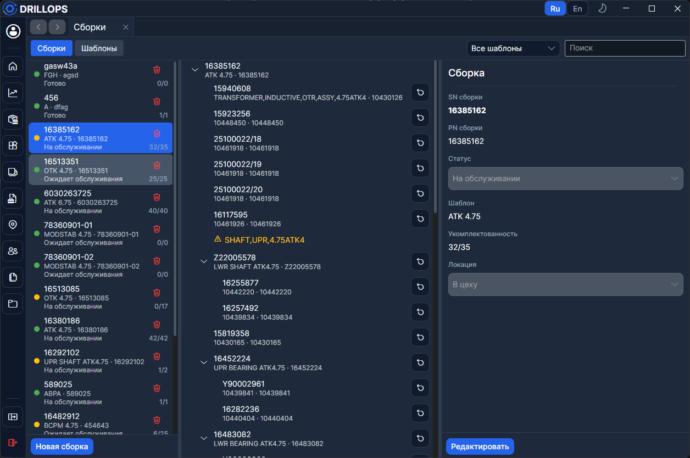
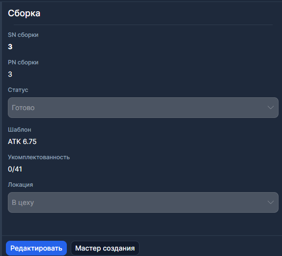
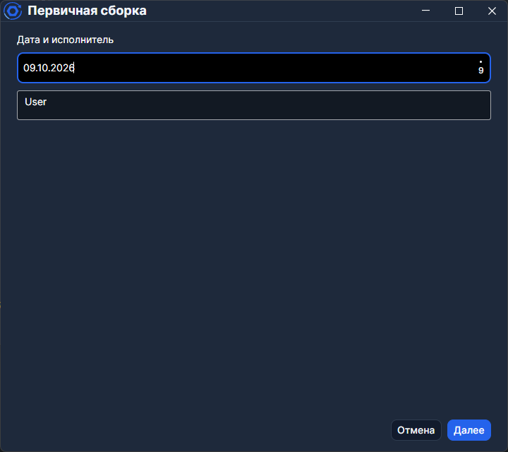
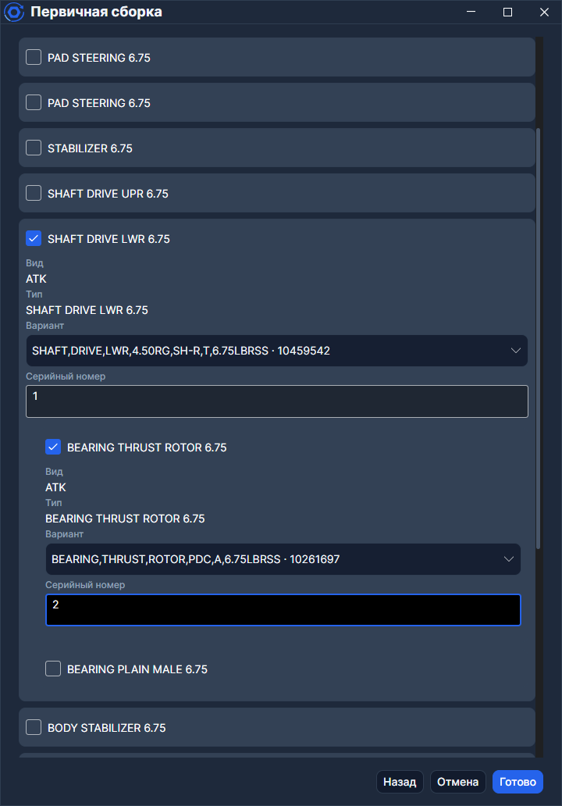

# Сборки

**Сборка** — экземпляр инструмента: корневой [компонент](./Компоненты.md) плюс дерево слотов по [шаблону](./Шаблоны.md). На вкладке два режима: **Сборки** и **Шаблоны** (переключатель сверху).

## Дерево и комплектация

Пустой слот подписан **типом компонента** который должен в нём находится. **Укомплектованность** N/M — сколько слотов занято (та же логика, что индикатор на [Главной](../Рабочий%20цикл/Главная.md)).

> Неполная сборка всё равно может уехать в поле — программа спросит подтверждение. То же при закрытии [заказ-наряда](../Рабочий%20цикл/Заказ-наряд.md).

Комплектацию, которая должна остаться в истории, делают операцией **Сборка** или **Разборка** в [заказ-наряде](../Рабочий%20цикл/Заказ-наряд.md). Кнопки **Назначить компонент** и **Извлечь** на этой вкладке меняют дерево без такой записи. Один компонент не может стоять в двух сборках сразу.

В карточке сборки показано **время наработки** головного компонента — те же часы, что в [карточке компонента](./Компоненты.md) и [сводке](../Отчёты/Сводка.md).

## Создание

Новую сборку собирают из **шаблона**, корневого **компонента** и парт-номера. На [Главную](../Рабочий%20цикл/Главная.md) попадают только сборки головных инструментов.

После создания дерево слотов пустое. Дальше два пути:

1. **Мастер создания** — кнопка в карточке пустой сборки. Заполняет слоты новыми компонентами и сразу заводит связанные документы.
2. Операция **Сборка** в заказ-наряде — если детали уже есть в справочнике.

> Мастер доступен только пока сборка пустая. Если слоты уже заняты, кнопка скрыта.

Контекстное меню строки открывает [последнюю отправку](../Рабочий%20цикл/Отправки.md), [наряд](../Рабочий%20цикл/Заказ-наряд.md), [полевые данные](../Рабочий%20цикл/Полевые%20данные.md) или [сводку](../Отчёты/Сводка.md).

## Мастер создания

Кнопка **Мастер создания** открывает диалог **Первичная сборка**.

### Шаг 1. Дата и исполнитель

Укажите дату первичной сборки и исполнителя. Без прав администратора дату позже сегодня выбрать нельзя.

### Шаг 2. Заполнение слотов шаблона

Для каждого слота шаблона (включая вложенные) можно включить галочку и задать:

- **вариант** ожидаемого типа;
- **серийный номер** нового компонента.

Слот можно оставить пустым — тогда его не заполнят. Один и тот же серийный номер в нескольких слотах программа не примет; номер не должен совпадать с уже существующим компонентом.

На **Готово** мастер:

- ставит созданные компоненты в слоты (в том числе во вложенные сборки);
- заводит запись [обслуживания](../Рабочий%20цикл/Обслуживание.md) и [заказ-наряд](../Рабочий%20цикл/Заказ-наряд.md) и **закрывает** их.

Это первичная комплектация, а не рейс в поле: сборка остаётся в парке, готовая к [отправке](../Рабочий%20цикл/Отправки.md). Пошагово — в сценарии [Как завести сборку](../Сценарии/Как%20завести%20сборку.md).
