# Как завести сборку

Сборка — единица оборудования в DrillOps. Сначала заводят справочники и пустую сборку, слоты заполняет **Мастер создания**. Он сам создаёт компоненты по варианту и серийному номеру, ставит их в дерево и закрывает обслуживание с заказ-нарядом этой первичной комплектации.

Вложенные детали заранее не заводите. Отдельный компонент нужен только корневой — тот, на котором собирается вся сборка.

Кнопкой **Назначить компонент** на вкладке **Сборки** слот не заполняют: в истории инструмента от этого ничего не остаётся. Если деталь уже заведена, её ставят операцией **Сборка** в [заказ-наряде](../Рабочий%20цикл/Заказ-наряд.md).

---

## Шаг 1. Откройте «Компоненты»

В боковом меню нажмите **Компоненты**.

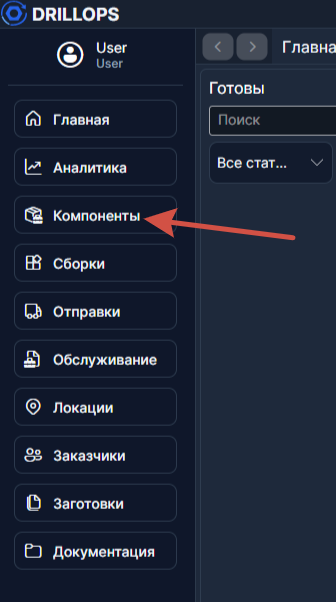

---

## Шаг 2. Создайте вид и тип

**Добавить** на верхнем уровне дерева — это **вид**, широкая группа вроде *Units*. На логику программы вид не влияет.

Выберите вид и снова **Добавить** — это **тип**, например *Unit Base*. Компоненты одного типа встают в один и тот же слот шаблона.

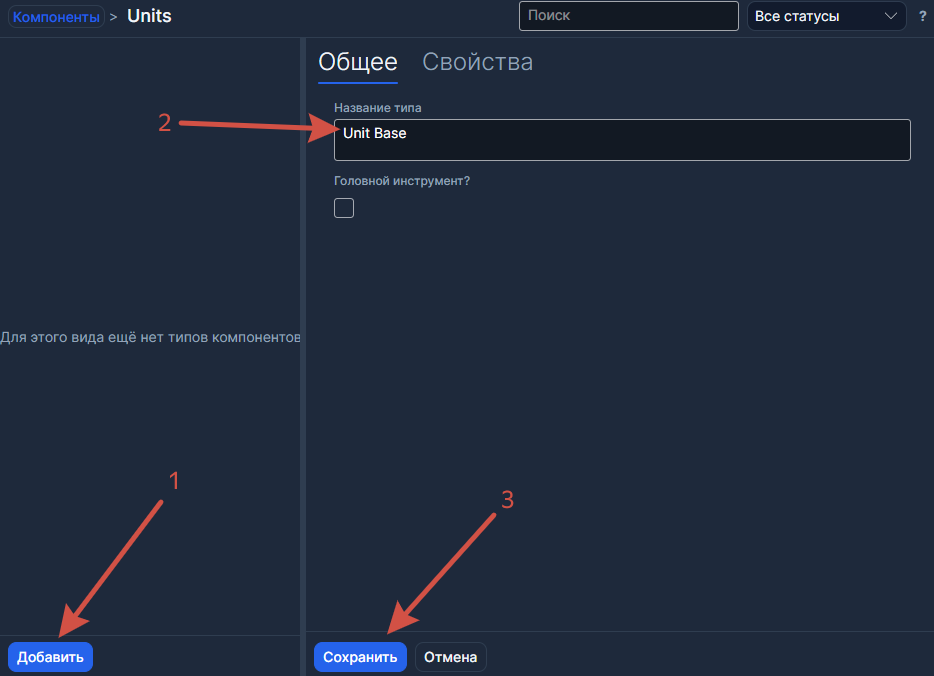

Если сборка должна быть на [Главной](../Рабочий%20цикл/Главная.md), у корневого типа включите **Головной компонент?**. У вложенной сборки этот флаг не нужен.

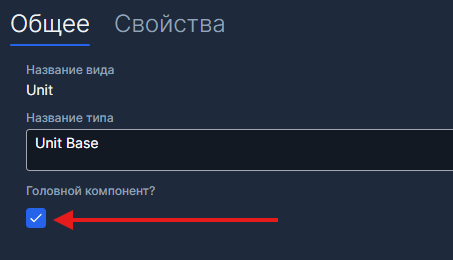

---

## Шаг 3. Создайте вариант

Выберите тип и **Добавить** на уровне варианта. Укажите наименование и **парт-номер**. Например: *Unit Base 0.5*, парт-номер *A111B22*.

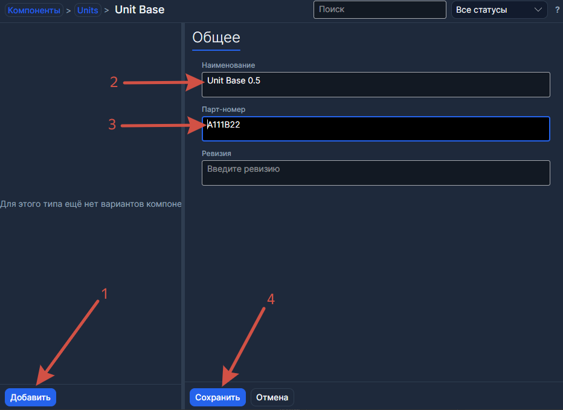

Повторите вид, тип и вариант для каждой разной детали сборки. Серийные номера вложенных деталей пока не вводите.

> Разные детали — разные **типы**. Разные парт-номера одной детали — **варианты** внутри одного типа. Если завести корпус, лопасти и переводники одним типом, шаблон не различит слоты.

---

## Шаг 4. Создайте только корневой компонент

Выберите вариант головного инструмента и **Добавить** на уровне компонента. Введите его **серийный номер**.

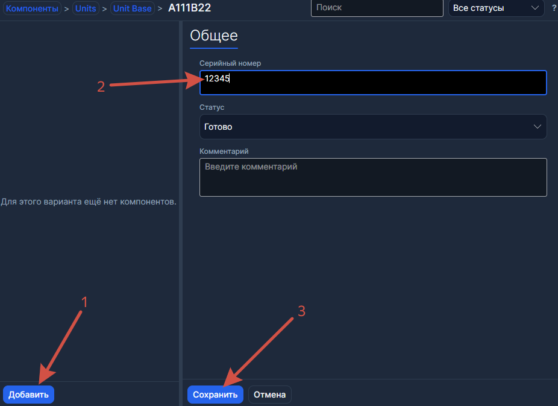

---

## Шаг 5. Соберите шаблон

Откройте **Сборки** и переключитесь в **Шаблоны**. **Создать**, выберите тип головного инструмента.

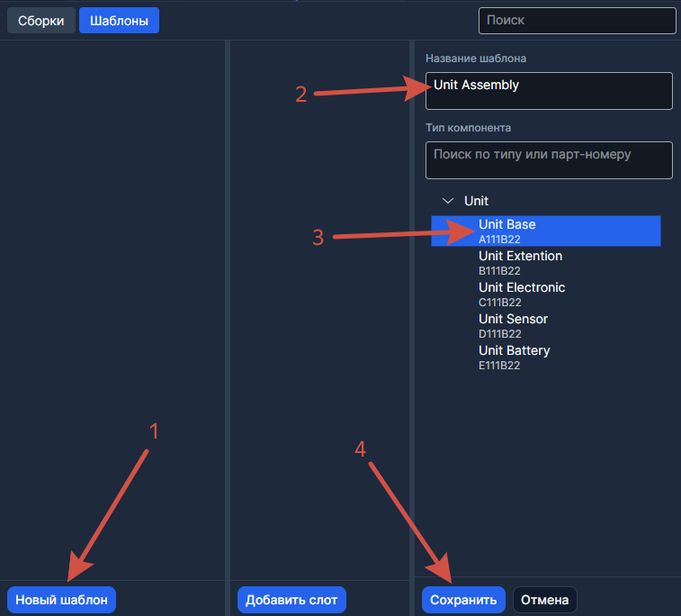

**Добавить слот** для каждой позиции и укажите тип, который должен в ней стоять.

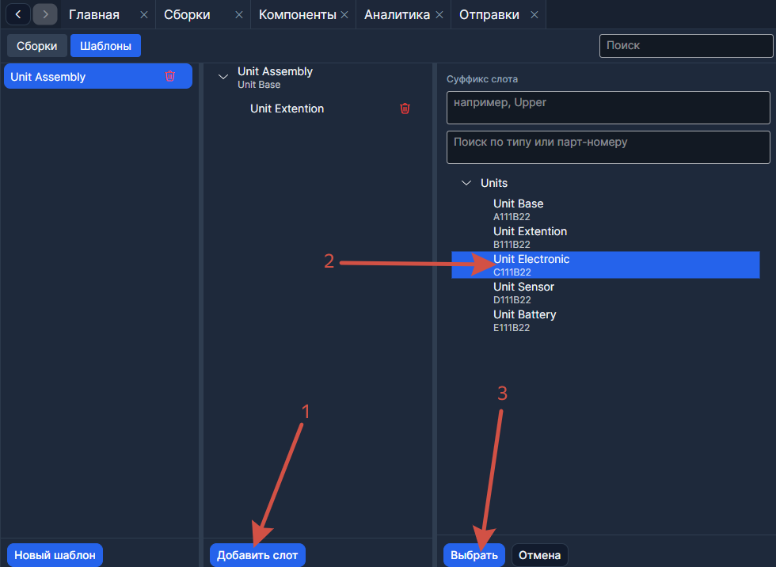

Один шаблон подходит нескольким сборкам одного типа.

---

## Шаг 6. Создайте вложенные сборки (если нужно)

Слот шаблона может ожидать не просто компонент, а **другую сборку** — например, расширение со своей внутренней структурой. В этом случае:

1. Создайте **отдельный шаблон** для вложенной сборки (так же, как на шаге 5, для её типа).
2. Укомплектуйте её **мастером создания** или операциями **Сборка** в заказ-наряде.

Потом, когда будете собирать основную сборку, готовую вложенную сборку ставят в слот той же операцией **Сборка**.

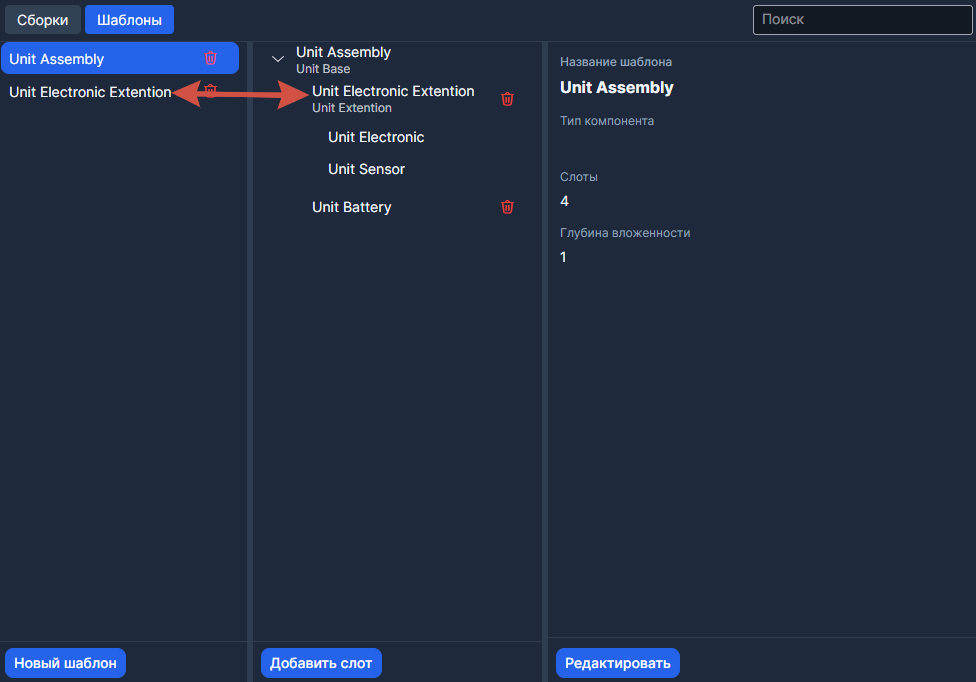

> Вложенная сборка — это полноценная сборка со своим серийным номером и шаблоном. Она не обязана быть головным инструментом (флаг **Головной компонент?** для неё не нужен).

---

## Шаг 7. Создайте пустую сборку

Переключитесь в режим **Сборки** и нажмите **Создать**:

- **Шаблон** — из шага 5.
- **Корневой компонент** — из шага 4.
- **Парт-номер** подставится из варианта, его можно поправить.

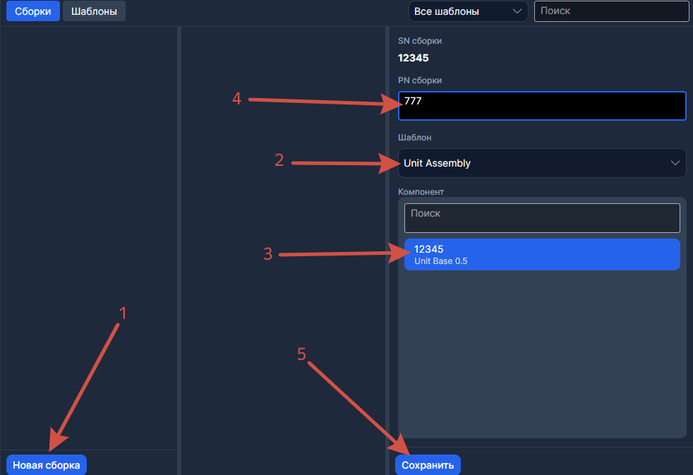

В дереве будут пустые слоты. Пока ни один не занят, в карточке видна кнопка **Мастер создания**.

---

## Шаг 8. Мастер: дата и исполнитель

Нажмите **Мастер создания**. Откроется **Первичная сборка**, шаг **Дата и исполнитель**.

Укажите дату комплектации и исполнителя. Без прав администратора дату позже сегодня выбрать нельзя. Нажмите **Далее**.

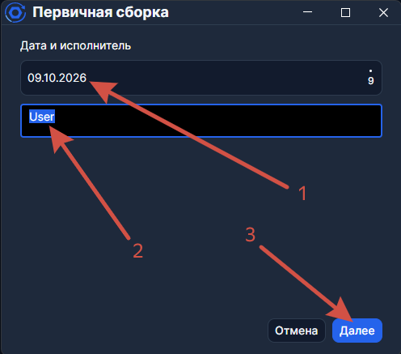

---

## Шаг 9. Мастер: слоты

Шаг **Заполнение слотов шаблона**. У каждого слота галочка. Включите те, которые заполняете сейчас.

У включённого слота видны **вид** и **тип**. Выберите **вариант** и введите **серийный номер**. Мастер заведёт новый компонент, уже существующий из списка не подставляет.

Вложенные слоты показаны внутри родительского, их заполняют так же. Слот без галочки останется пустым.

Один серийный номер нельзя указать дважды и нельзя повторить номер, который уже есть у этого парт-номера.

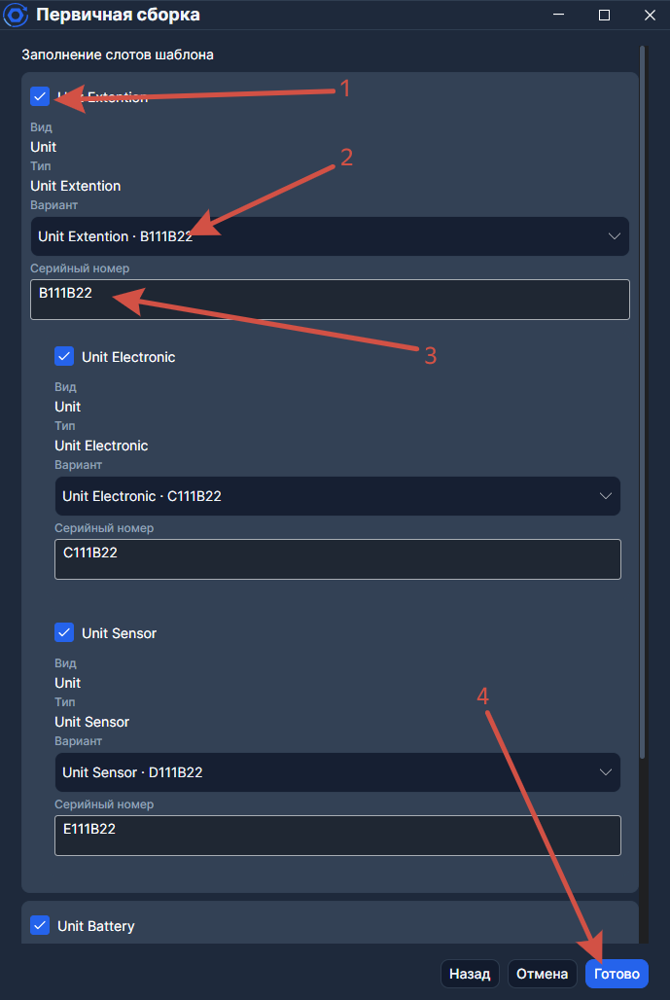

**Готово**. Мастер ставит компоненты в дерево, в том числе во вложенные сборки, и закрывает обслуживание с заказ-нарядом. Это комплектация в цеху, не отправка в поле.

> Важно делать именно через первоначальную сборку для того чтобы это отразилось в истории инструмента!

---

## Шаг 10. Проверьте результат

**Укомплектованность** покажет, сколько слотов занято, например *3/3*. После мастера кнопка **Мастер создания** скрыта: сборка уже не пустая.

Если корневой тип — головной инструмент и компонент в статусе **Готово**, сборка появится на [Главной](../Рабочий%20цикл/Главная.md) в столбце **Готовы**.

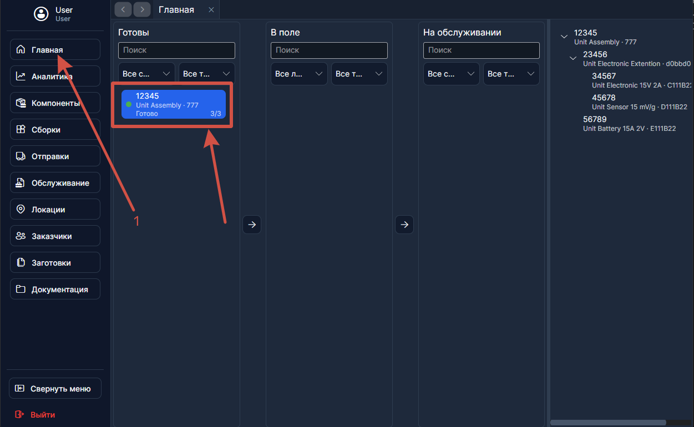

Дальше её можно [отправить в поле](./Как%20отправить%20в%20поле.md). Неполную тоже можно — программа спросит подтверждение.

---

# Если компоненты уже есть

Мастер заводит новые компоненты и не подставляет уже заведённые. Ниже — как поставить готовую деталь в слот через заказ-наряд. Кнопку **Назначить компонент** на вкладке **Сборки** не используйте: в истории инструмента от этого ничего не остаётся.

---

## Шаг 1. Отправьте сборку на обслуживание

Откройте [Главную](../Рабочий%20цикл/Главная.md). В столбце **Готовы** щёлкните карточку правой кнопкой и выберите **Отправить на обслуживание**.

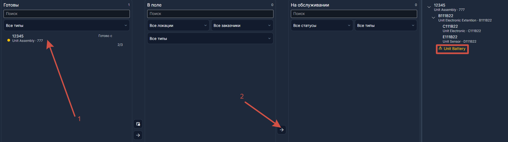

Подтвердите **Да** в диалоге **Начать обслуживание**. Сборка перейдёт в столбец **На обслуживании**.

---

## Шаг 2. Откройте заказ-наряд

В столбце **На обслуживании** снова щёлкните карточку правой кнопкой и выберите **Открыть обслуживание**.

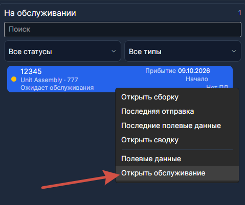

Откроется [заказ-наряд](../Рабочий%20цикл/Заказ-наряд.md) этой сборки.

---

## Шаг 3. Нажмите «Добавить»

В таблице **Операции** нажмите **Добавить**. Откроется мастер **Новая операция**.

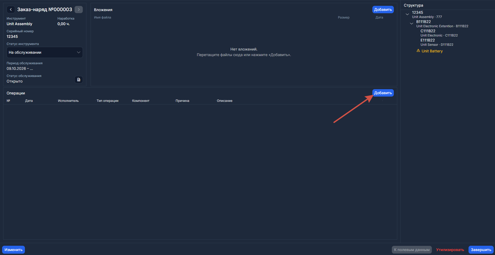

---

## Шаг 4. Укажите дату, исполнителя и тип

На шаге **Дата и исполнитель** выберите дату и исполнителя. В списке **Тип операции** выберите **Сборка**. Нажмите **Далее**.

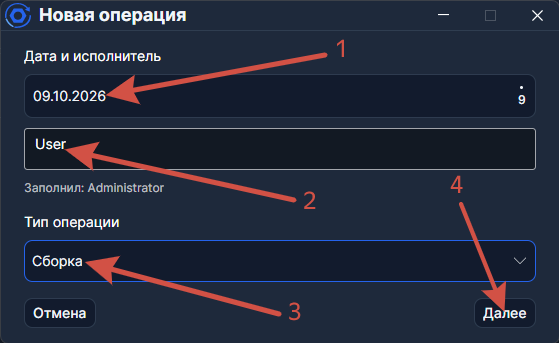

---

## Шаг 5. Выберите слот и компонент

Заполните **Причину**. В списке **Слот** выберите пустое место в дереве. В списке **Компонент** найдите уже заведённую деталь.

В списке только компоненты нужного типа в статусе **Готово**, которые нигде не стоят. Если подходящих нет, программа напишет **Нет доступных компонентов для этого типа слота**.

**Описание** можно оставить пустым. Нажмите **Готово**.

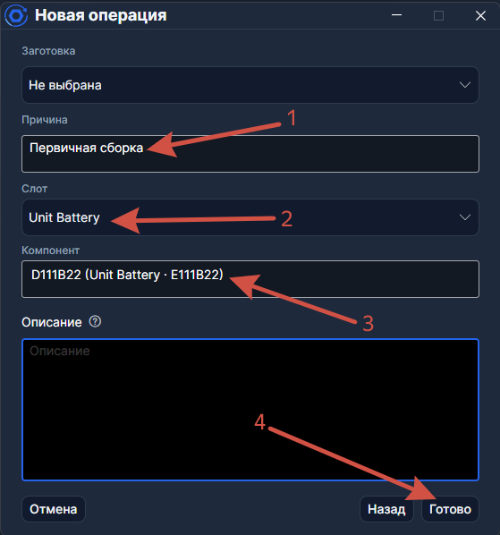

Операция появится в таблице наряда, компонент встанет в слот.

---

## Шаг 6. Повторите для остальных слотов

Для каждого следующего слота снова **Добавить** и операция **Сборка**. Вложенную сборку ставят так же: в **Компонент** выбирают её серийный номер.

> Сначала проведите первичную сборку для **подсборки** прежде чем вставлять её в основную сборку.

---

## Шаг 7. Завершите заказ-наряд

Когда слоты заполнены, нажмите **Завершить** и подтвердите **Завершить обслуживание?**.

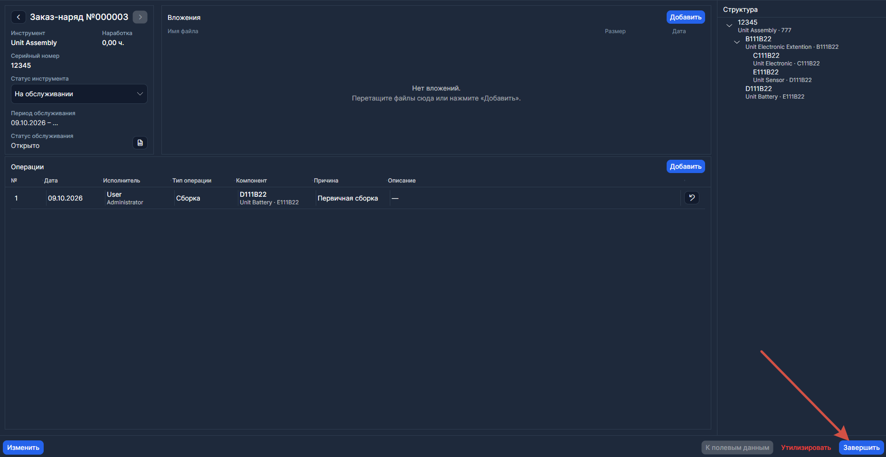

Сборка вернётся в столбец **Готовы**. Установки останутся в истории наряда.
