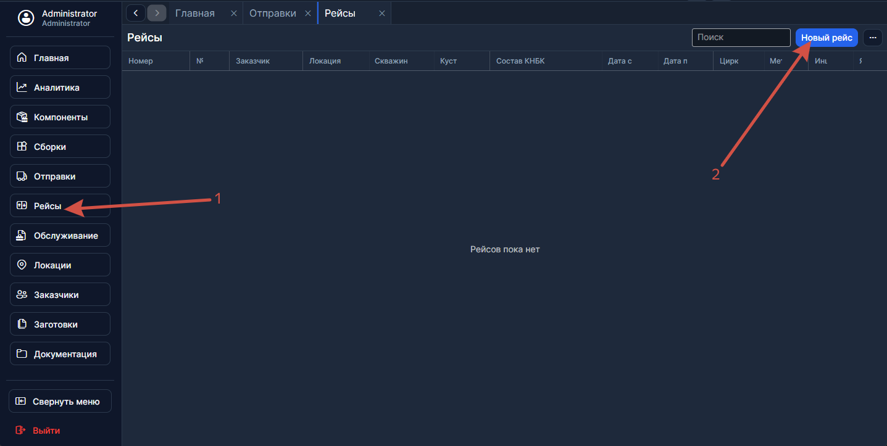
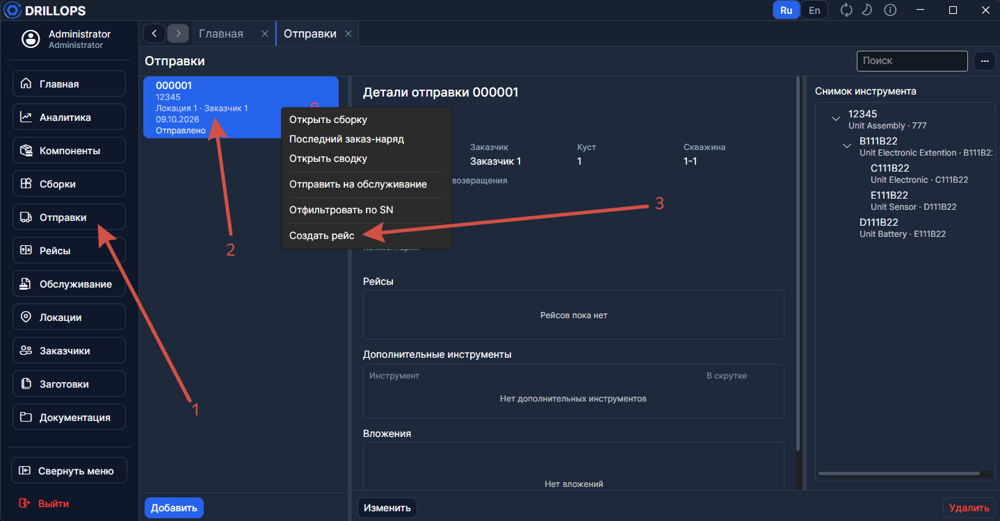
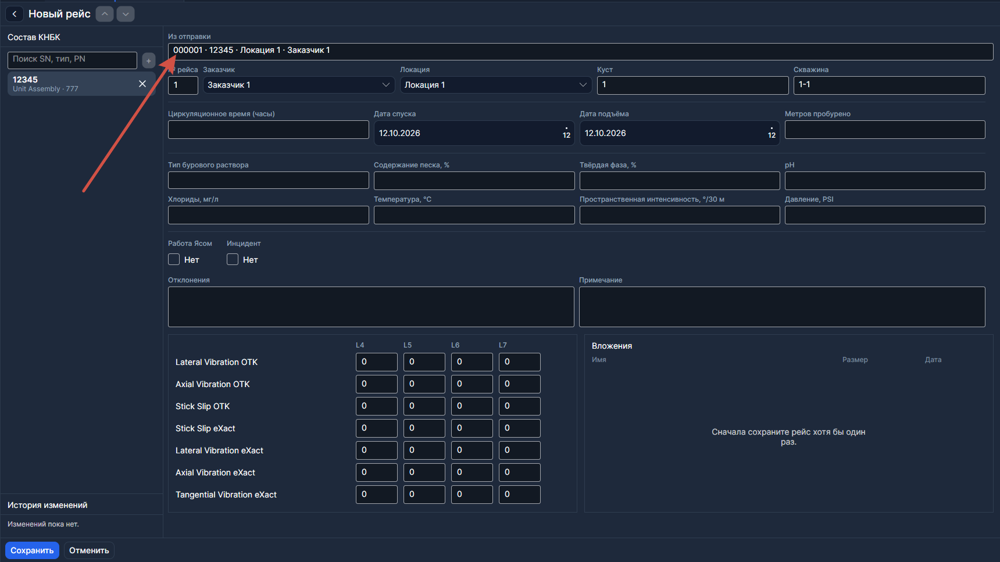
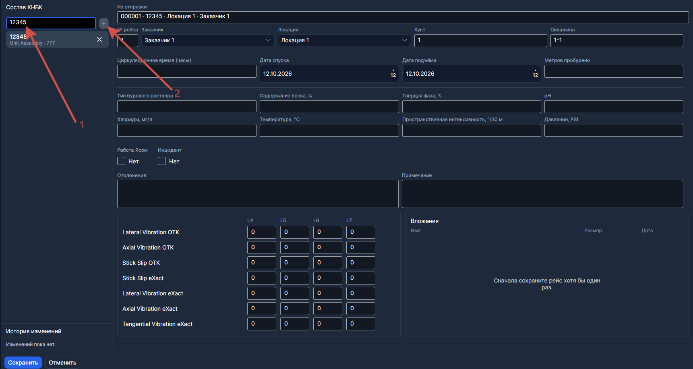
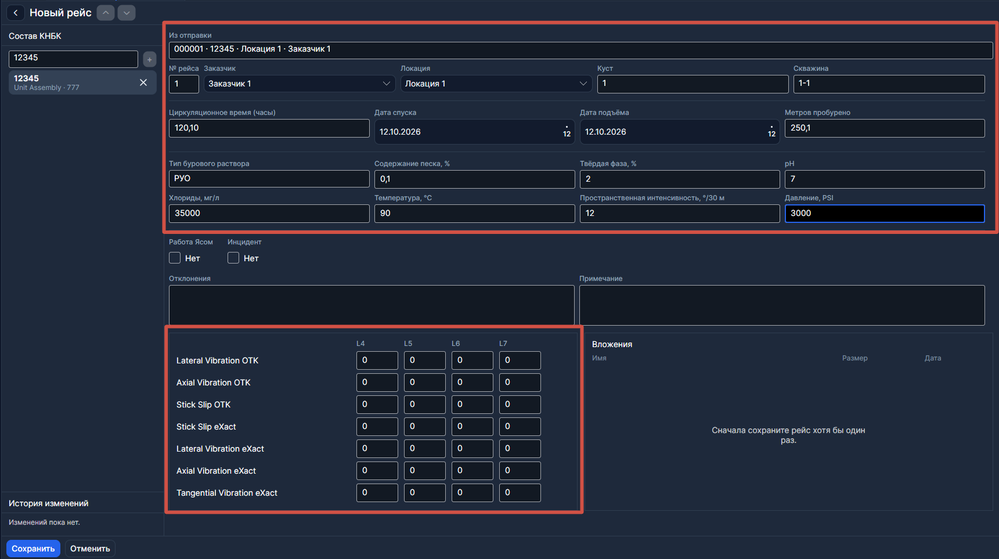
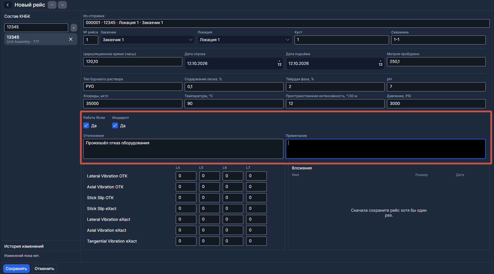
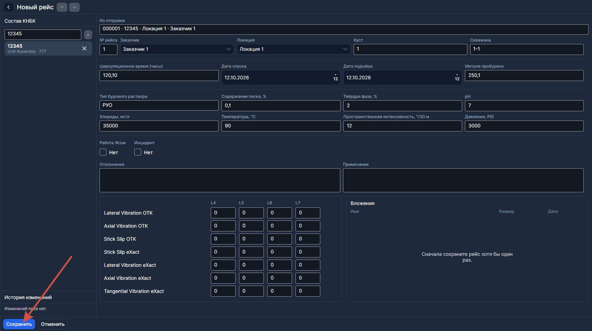
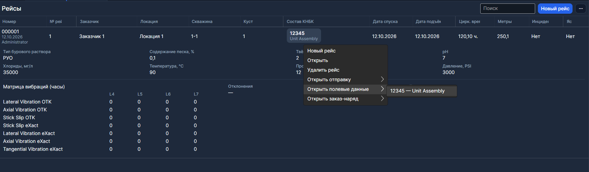
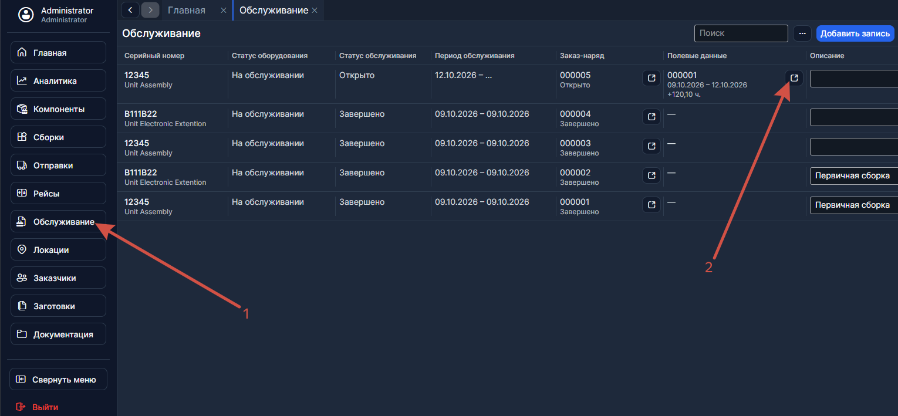

# Как завести рейс

Если сборка уже [отправлена](./Как%20отправить%20в%20поле.md) рейс можно завести на вкладке [Рейсы](../Рабочий%20цикл/Рейсы.md). Полевые данные потом покажут этот рейс.

---

## Шаг 1. Откройте новый рейс

В боковом меню нажмите **Рейсы**, затем **Новый рейс**.

Либо в [Отправках](../Рабочий%20цикл/Отправки.md) щёлкните нужную запись правой кнопкой и выберите **Создать рейс**. Отправка уже будет выбрана.

---

## Шаг 2. Подставьте отправку

В новом рейсе вверху есть список **Из отправки**. Выберите отправку, к которой относится спуск.

Программа заполнит заказчика, локацию, куст, скважину и состав КНБК. Поля можно поправить. Если создать рейс из отправки этот шаг можно пропустить.

---

## Шаг 3. Проверьте состав

Слева — **Состав КНБК**. Найдите сборку по серийному номеру и добавьте её кнопкой **+**. Нужен хотя бы один инструмент.

> Даты рейса должны целиком попасть в отправку каждого инструмента из состава. Иначе при сохранении будет ошибка **Даты рейса вне отправок**.

---

## Шаг 4. Заполните спуск

Укажите **№ рейса**, **дату спуска**, **дату подъёма**, **циркуляционное время** в часах и **метров пробурено**. При необходимости — параметры бурения и матрицу вибраций.

---

## Шаг 5. Отметьте инцидент (если был)

Включите **Инцидент** и опишите, что случилось, в поле **Отклонения**. Если была работа ясом, включите **Работа Ясом**.

> Инцидент отобразится значком предупреждения на карточке сборки на [Главной](../Рабочий%20цикл/Главная.md).

---

## Шаг 6. Сохраните

Нажмите **Сохранить**. Рейс появится в таблице. Щелчок по строке раскрывает подробности. Двойной щелчок или пункт **Открыть** открывает карточку для просмотра; чтобы править, нажмите **Изменить**. Прошлые сохранения лежат в **Истории изменений**.

---

## Шаг 7. Посмотрите рейс в полевых данных

ПКМ по строке рейса → **Открыть полевые данные**. Откроется окно этой отправки: рейс в списке слева, цифры справа только для чтения.

Туда же ведёт пункт **Последние полевые данные** у отправки и ячейка полевых данных в [Обслуживании](../Рабочий%20цикл/Обслуживание.md).

Если рейсов несколько — повторите шаги 1–6. Каждый сохранится отдельно и попадёт в полевые данные той отправки, в чьи даты легла дата спуска.

---

## Что дальше

Когда инструмент вернулся, отправьте его **на обслуживание** с Главной. Затем [проведите обслуживание](./Как%20провести%20обслуживание.md): заказ-наряд открывается из записи обслуживания, отдельно «завершать» полевые данные не нужно.
