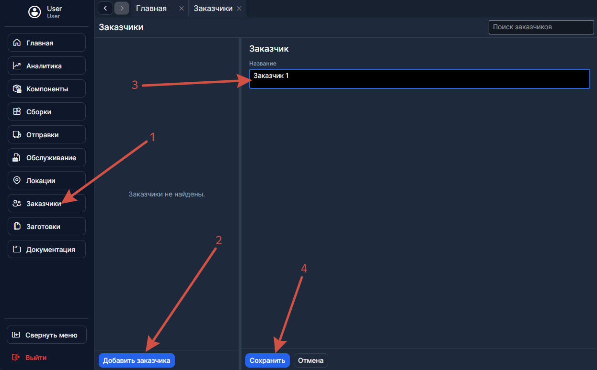
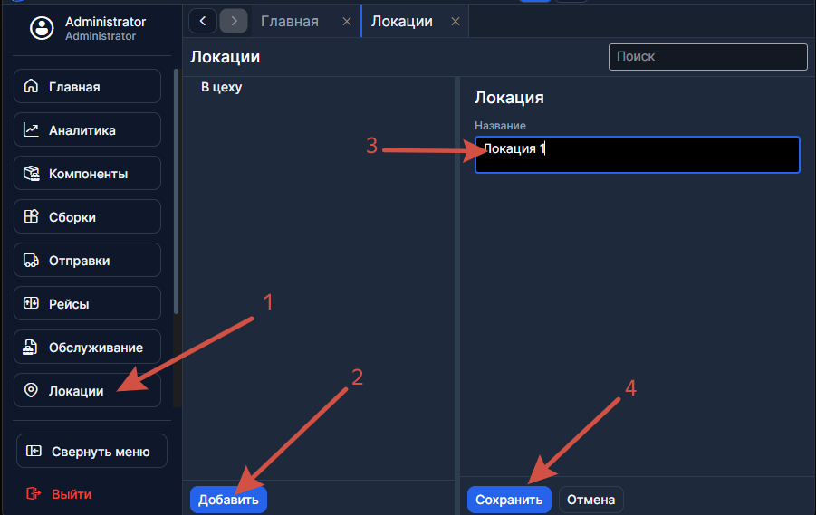
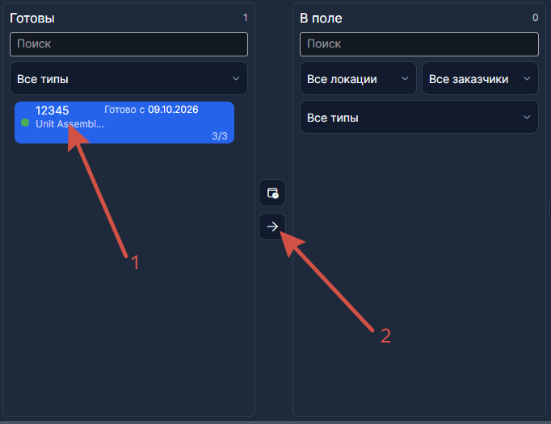
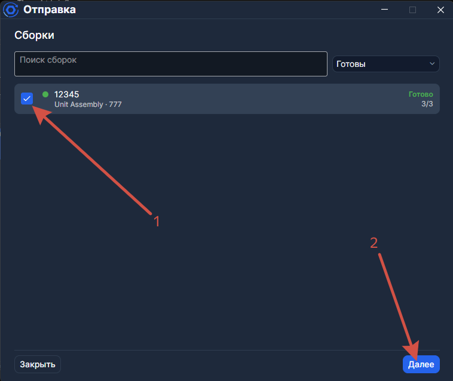
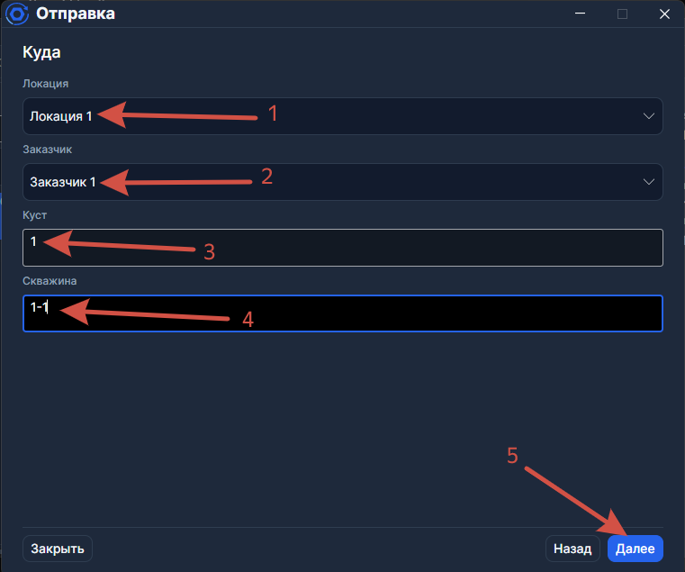
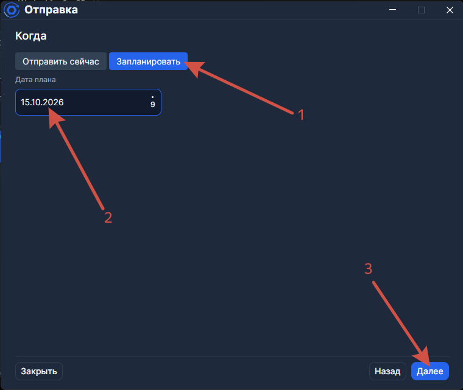
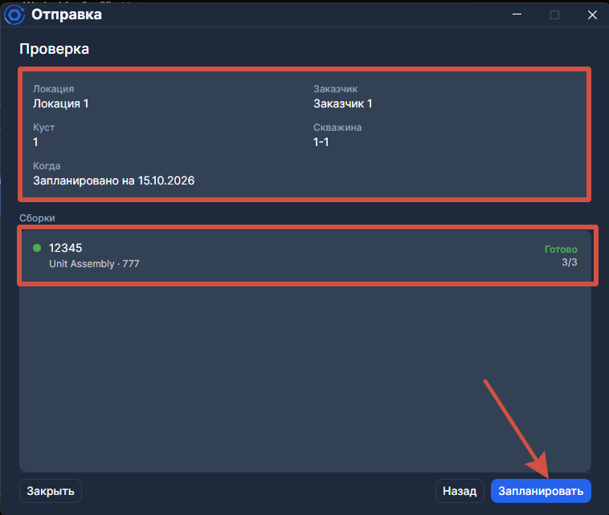
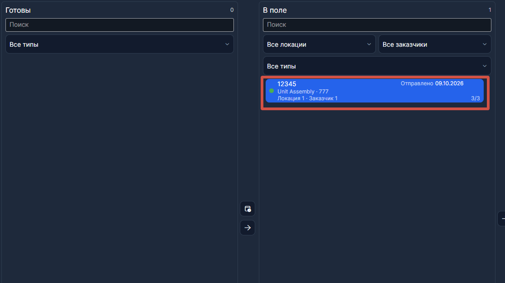
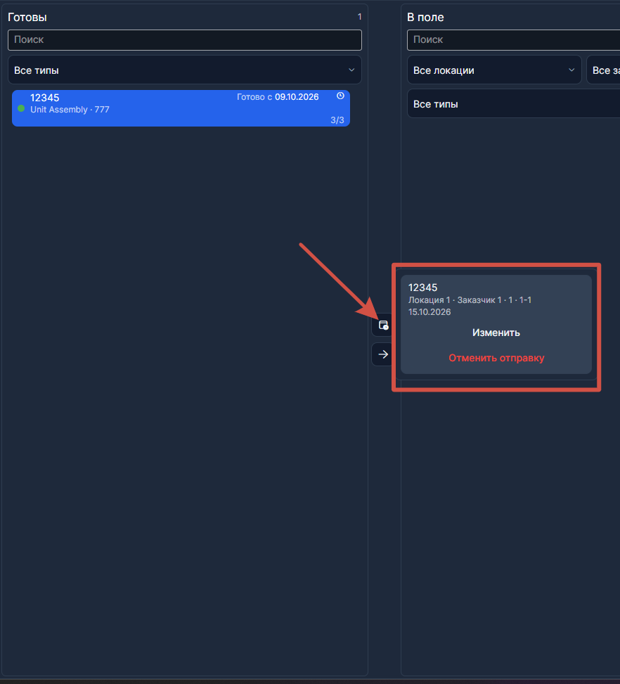

# Как отправить в поле

Сборка стоит в столбце **Готовы** на [Главной](../Рабочий%20цикл/Главная.md). Ниже — как отправить её заказчику или поставить отправку в план.

---

## Шаг 1. Убедитесь, что заказчик существует

Откройте [Заказчики](../Справочники/Заказчики.md) в боковом меню. Если нужного заказчика нет — нажмите **Добавить** и создайте его.

---

## Шаг 2. Убедитесь, что локация существует

Откройте [Локации](../Справочники/Локации.md). Если нужного объекта нет — нажмите **Добавить** и создайте локацию.

> Системную локацию **В цеху** не трогайте — она назначается автоматически.

---

## Шаг 3. Откройте мастер отправки

На **Главной** в столбце **Готовы** выберите карточку и нажмите **Отправить в поле**. Тот же мастер открывается кнопкой **Добавить** в [Отправках](../Рабочий%20цикл/Отправки.md).

> Чтобы выбрать **несколько** сборок, зажмите **Ctrl** (по одной) или **Shift** (диапазон). Они попадут в мастер уже отмеченными.

---

## Шаг 4. Сборки

На шаге **Сборки** отметьте, что поедет. Поиск и фильтр по столбцам парка сужают список. Зелёный кружок — слоты заполнены, жёлтый — нет.

---

## Шаг 5. Куда

Нажмите **Далее** и заполните:

- **Локацию** — куда едет инструмент.
- **Заказчика**.
- **Куст** и **Скважину**.

---

## Шаг 6. Когда

- **Отправить сейчас** — сборка сразу уходит в **В поле**. Доступно, только если все выбранные сборки **Готовы**.
- **Запланировать** — укажите **дату плана** (сегодня или позже). Сборка остаётся в текущем столбце, в журнале появится статус **Запланировано**.

---

## Шаг 7. Проверка и подтверждение

На шаге **Проверка** сверьте локацию, заказчика, куст, скважину и срок.

Если сборок несколько, одна помечена как **Основная**. У остальных выберите **В скрутке** или **Вместе**.

Нажмите **Отправить сейчас** или **Запланировать**. Если сборка укомплектована не полностью, программа спросит подтверждение.

---

## Шаг 8. Проверьте результат

**Отправить сейчас:** сборка в столбце **В поле**, в [Отправках](../Рабочий%20цикл/Отправки.md) есть запись со снимком структуры. Дата возвращения заполнится, когда сборку отправят на обслуживание.

**Запланировать:** сборка остаётся в **Готовы**. План виден в списке **Запланированные отправки** на Главной. Когда сборка готова, строка будет **Можно отправить** — отправьте её оттуда или кнопкой **Отправить** в карточке.

---

## Что дальше

Пока инструмент в поле, можно завести [рейсы](./Как%20заполнить%20полевые%20данные.md). Когда он вернётся, отправьте его [на обслуживание](./Как%20провести%20обслуживание.md) с Главной и откройте заказ-наряд.
